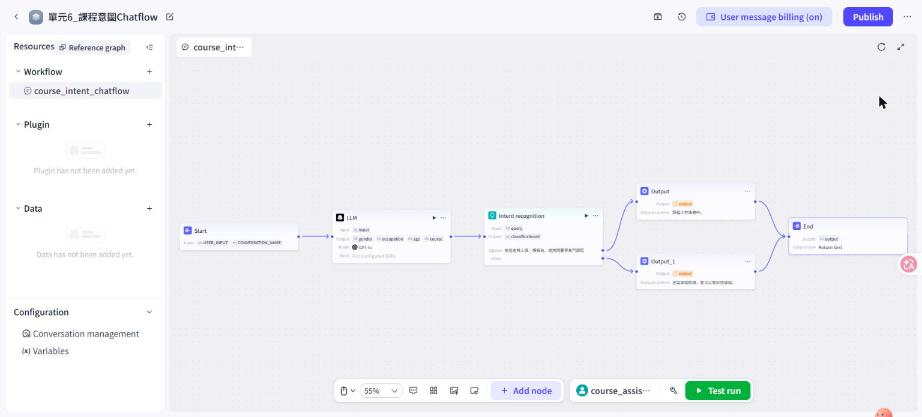
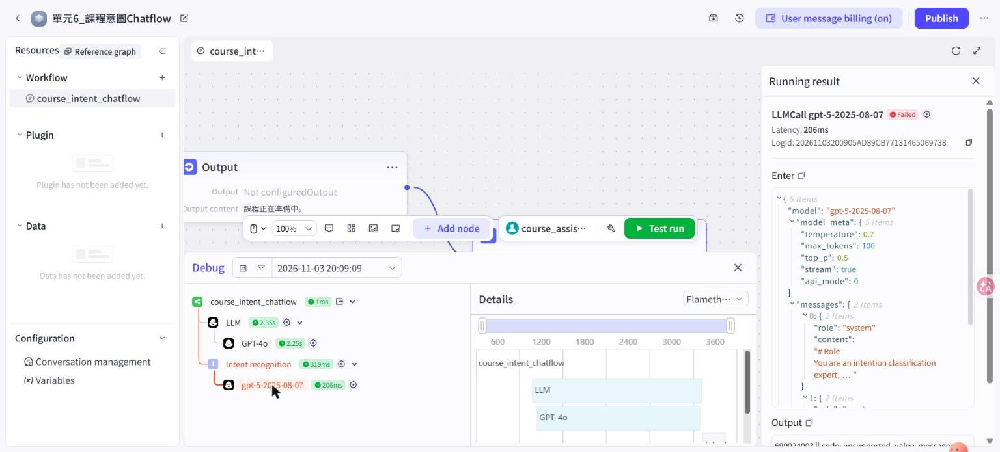
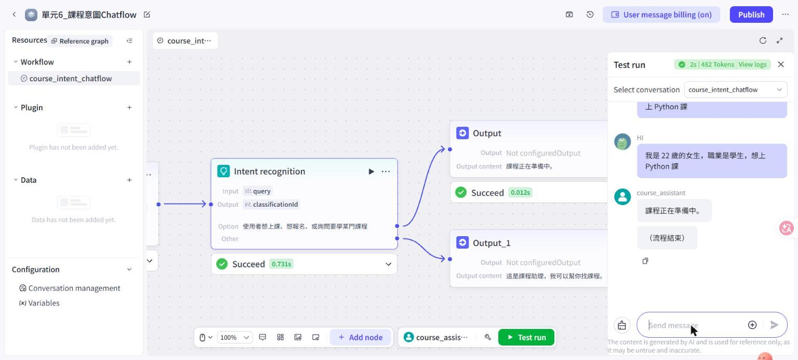
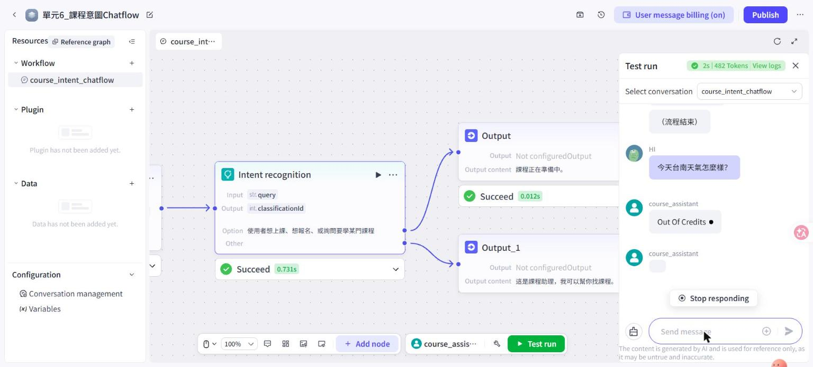
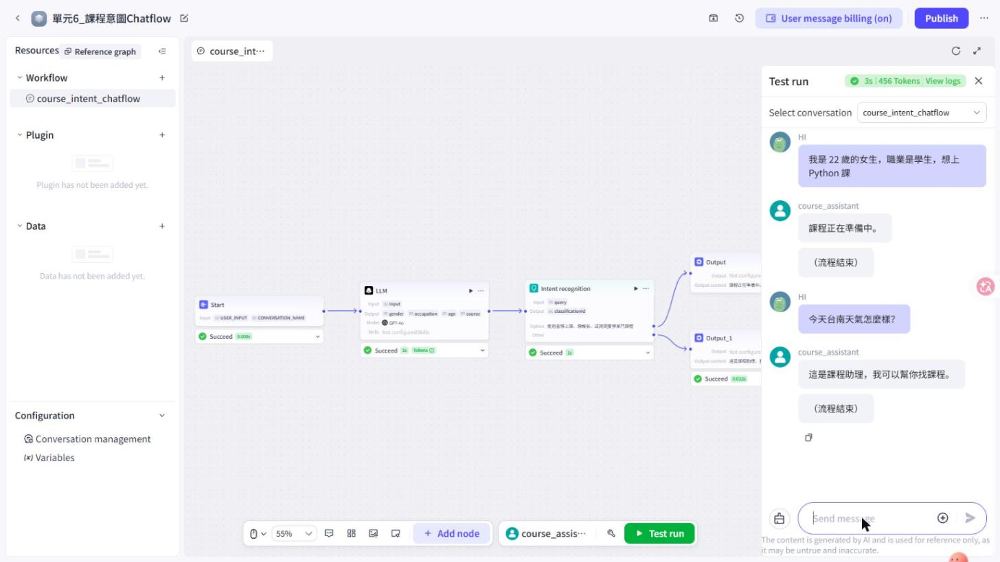
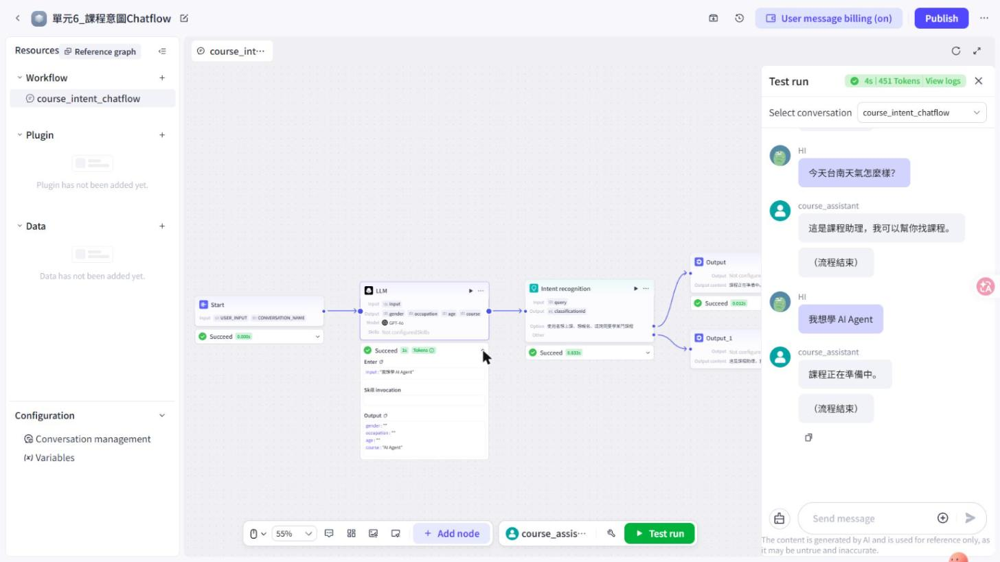
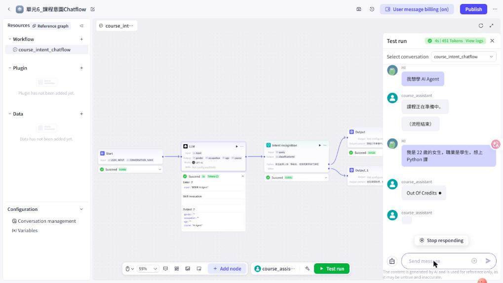

# Agent 的流程骨架：Chatflow 的抽取、意圖判斷與分流（單元 6）學習文件

專案：客服 Agent（AuraBrew 模擬產品，假資料，老師允許）　姓名 / 學號 / 班級：趙若軒 / 113801517 / 生醫三　Repo：https://github.com/hehehe2306/auraBrew-support-agent

**期末專題目標：**做一個「美股 IBKR 個人財務分析助理」Agent——讀取 IBKR 模擬帳戶的持倉與餘額，結合利率、匯率等宏觀資料，解釋保證金與利差帶來的風險，並稽查自己算出的數字有沒有錯；只做分析與稽查，下單與槓桿水位交給人決定。本週的單元 6 對應其中「用固定流程決定資料先走哪一步」，這是單元 5 結論裡「把不能讓模型選的步驟變成固定節點」的第一次實作。

> 草稿狀態（2026-11-06）：流程已建好，T1–T3 三題都測到（11-03 測 T1；11-06 補測 T2、T3）。**T1 的欄位抽取內容沒看到**：11-06 想重跑 T1 時 Coze 額度又用完了（附圖 7），仍標【待補】。**沒有任何結果是預先寫好的。**「結論摘要」與「這一節教了我什麼」是我先寫的草稿，請你改成自己的話。

## 結論摘要

**做了什麼：**在 Coze 的 App 裡建一個 Chatflow：Start → LLM 節點（抽出性別、職業、年紀、想上的課）→ 意圖辨識節點（想上課／其他）→ 兩個回覆節點 → End。課綱的檢核是：想上課就回「課程正在準備中」，不是就說「這是課程助理」。

**目前測到的：**
- T1「我是 22 歲的女生，職業是學生，想上 Python 課」→ 走「課程正在準備中」（附圖 3）。
- T2「今天台南天氣怎麼樣？」→ 走 Other，回「這是課程助理，我可以幫你找課程。」（附圖 5）。**兩條路都走對了。**
- T3「我想學 AI Agent」→ 抽取節點輸出 gender、occupation、age 皆為空字串，course 為 "AI Agent"，沒有憑空補欄位（附圖 6）。
- **還沒看到的：**T1 的抽取內容（性別 female、職業學生、年紀 22 有沒有抽對）。我 11-06 想重跑時額度又用完（附圖 7）。每題只跑 1 次。

**最值得記的坑（和觀念有關，不是平台雜事）：**① 同一個 Chatflow 裡，兩種節點的預設模型不一樣，意圖辨識節點的預設模型（gpt-5）直接失敗，換成 GPT-4o 才過（附圖 2）；② 流程「結構」是我畫的，模型只在節點內做判斷——這和單元 5 發現的「Prompt 寫了一律先 browse 仍被忽略」形成對比，我預期這是 Chatflow 的價值，但目前只有 1 題，**還不能說它比較穩**。

**主問題（先寫下，之後對答案）：**把「該走哪條路」從 Prompt 搬到流程節點，Agent 的行為會更可預期嗎？

## 零、概念

課綱要我學四件事：拖拉畫布、LLM 節點、參數提取、意圖判斷，並建立自動化流程。

**1. Chatflow 與 Workflow 差在哪？** 推理：Workflow 是「輸入一次、跑完一串節點、回結果」；Chatflow 多了對話，會帶歷史與使用者每輪輸入。**這是我依介面推的**：建立時要綁一個同名的對話，測試是聊天框。官方文件我沒另外查。

**2. 節點是什麼？** 每個節點是流程裡的一個固定步驟，有輸入、輸出。我這次用到：Start（接使用者文字）、LLM（呼叫模型）、Intent recognition（意圖辨識）、Output（回覆）、End（結束）。

**3. 參數提取（抽取欄位）。** 我用的做法是一個 LLM 節點，System Prompt 要求只抽出 gender、occupation、age、course，沒提到就回空字串，輸出格式設成 JSON，輸出變數就是這四個。**這是用 LLM 做抽取，不是規則**：模型可能猜錯或亂補，這正是第四節的稽查想要檢查的地方。

**4. 意圖辨識。** 節點讓我寫一個「想上課」的意圖描述，其餘一律走 Other。它回一個 `classificationId`，流程依它分支。我只寫了一個意圖，**不是**把每一種意圖都列出來。

**IPO（老師的檢查方法）：**

| | 抽取節點 | 意圖辨識節點 |
| :- | :- | :- |
| Input | 使用者原話 | 使用者原話 |
| Process | LLM 依 System Prompt 判讀 | LLM 把原話對照我寫的意圖描述 |
| Output | 四個字串欄位 | 分類編號，決定走哪條線 |
| 怎麼驗證 | 對照原話，欄位有沒有憑空補出來（T3 看到沒補；T1 完整資訊的內容【待補】） | 想上課／非想上課兩類各看一題（T1、T3 走想上課；T2 走 Other） |

## 一、實作簡介與檢核標準

**課綱檢核標準：**
1. 一個 Chatflow 的流程截圖與實際對話截圖。
2. 使用者說話時，LLM 嘗試提取性別、職業、年紀、想上什麼課。
3. 透過意圖辨識做自然語言的邏輯判斷。
4. 想上課就回「課程正在準備中」；不是就說「這是課程助理」。

**我的設定：**
- 位置：Coze 新建 App「單元6_課程意圖Chatflow」，Chatflow 名稱 `course_intent_chatflow`（不動前幾單元的 Agent）。
- 抽取節點模型 GPT-4o；意圖辨識節點模型我改成 GPT-4o（原因見第二章）。
- 回覆用兩個 Output 節點，內容是固定文字；End 節點填「（流程結束）」。
- 性別欄位沿用單元 3 的格式 `male` / `female` / 空值（見單元 3 文件）。

**與檢核標準的對照：**

| 要求 | 我實際做的 | 差異與原因 | 證據 |
| :- | :- | :- | :- |
| 流程截圖 | 完整節點圖 | 無 | 附圖 1 |
| 抽取四欄 | LLM 節點定義了四個輸出欄位；T3 展開看到輸出 | **只有 T3 看到抽取內容**（缺資料時三欄為空、course 抽到）；T1 完整資訊的抽取內容沒看到 | 附圖 1、6 |
| 意圖辨識 | T1、T3 走想上課；T2 走 Other | 三題各 1 次，結論是「看到對的結果」，不是準確率 | 附圖 3、5、6 |
| 兩種回覆 | 「課程正在準備中。」與「這是課程助理，我可以幫你找課程。」都實際出現 | 每句後面都多一句「（流程結束）」 | 附圖 3、5 |

整體判斷：**流程完成、檢核只達成一半**，文件如實寫。

### 這次的設定值為什麼存在（為何存在／解決什麼問題）

| 設定 | 這次的值 | 為何存在 | 這次看到的影響 |
| :- | :- | :- | :- |
| LLM 節點輸出格式 | JSON，四個字串欄位 | 讓下游節點拿到「有名字的欄位」而不是一整段文字；這是 Chatflow 比純 Prompt 多出的結構 | 節點上看得到四個輸出變數（附圖 1）；T3 的實際輸出格式是 `gender: ""` 等四行（附圖 6）；T1 的內容【待補】 |
| 抽取 Prompt 的「沒說就回空字串、不要猜」 | 已寫入 | 防止模型為了填滿欄位而編造（和單元 3 的 `null` 規則同一目的） | T3「我想學 AI Agent」：性別、職業、年紀都回空字串，沒有被補（附圖 6）；只跑 1 次 |
| 意圖辨識的模型 | gpt-5 → GPT-4o | 意圖辨識需要穩定地回分類編號 | 預設的 gpt-5 回 `unsupported_value`（附圖 2），換 GPT-4o 後成功 |
| Output 節點的輸出變數 | 刪除空變數 | Coze 檢查「變數值不可為空」，否則不給執行 | 不刪就無法測試，所以我刪了；回覆文字直接寫在內容欄 |
| End 節點 Response | 「（流程結束）」 | End 要求有回應內容 | 每次回覆後都多一句「（流程結束）」，我視為多餘，只是為了讓流程能跑 |

## 二、測試集

只做能回答觀念問題的幾題，答完就停（老師：測試可以減量）。

| # | 輸入 | 要回答的觀念問題 | 預期（寫在跑之前） | 結果 |
| :- | :- | :- | :- | :- |
| T1 | 「我是 22 歲的女生，職業是學生，想上 Python 課」 | 完整資訊時，抽取四欄且走「想上課」那條路嗎？ | 四欄都抽到（female、學生、22、Python）；回「課程正在準備中」 | **回覆符合預期**：「課程正在準備中。（流程結束）」，2 秒、482 Token（附圖 3）。**T1 當次的四欄抽取內容我沒展開看**；11-06 想重跑 T1 時額度又用完（附圖 7）【待補】 |
| T2 | 「今天台南天氣怎麼樣？」 | 非想上課時，是否走 Other 並回「這是課程助理」？ | 回「這是課程助理，我可以幫你找課程。」 | **預測成立**（11-06）：走 Other，回「這是課程助理，我可以幫你找課程。（流程結束）」，3 秒、456 Token（附圖 5）。11-03 第一次嘗試時額度用完沒測到（附圖 4）。T2 的抽取節點輸出我沒展開看 |
| T3 | 「我想學 AI Agent」 | 缺資料時，欄位會不會被憑空補出來？ | 性別、職業、年紀為空；course 為 AI Agent；仍走想上課 | **預測成立**（11-06）：抽取輸出 gender、occupation、age 皆 `""`，course `"AI Agent"`；走「課程正在準備中」，4 秒、451 Token（附圖 6） |

**過程中的失敗（平台問題簡記；細節看附圖）：**第一次執行，意圖辨識節點失敗，錯誤碼 `699024003 || code: unsupported_value`，使用的模型是 gpt-5-2025-08-07，送出的設定是 temperature 0.7、max_tokens 100（附圖 2）。**我的推斷：**這個模型不接受節點送出的參數；我沒有查官方說明。換成 GPT-4o 後同一輸入成功。

### 結果分析

**我學到的（只寫實測看到的）：**
1. **同一個 Chatflow 裡，不同節點的預設模型可以不同，而且不一定能用。** 意圖辨識節點預設 gpt-5，執行時直接失敗；抽取節點用 GPT-4o 則成功。這是新的一種「工具掛上去不等於能用」：不是模型選不選它，而是節點設定本身就不通（對應單元 5 的觀察）。
2. **流程的錯誤會落在特定節點，除錯比單元 5 容易。**第一次失敗時，除錯面板的時間軸直接顯示：LLM 節點 2.35 秒成功、意圖辨識節點失敗在 206 毫秒的模型呼叫。單元 5 的外掛只回錯誤碼、看不到原因；這次我能指出是哪一個節點、哪一次模型呼叫（附圖 2）。
3. **缺資料時，抽取節點沒有硬填（這一次）。** T3 只說想學 AI Agent，性別、職業、年紀都是空字串，這和 System Prompt 的「沒說就回空字串」一致。但只有 1 次。
4. **分流確實由節點決定，兩條路都走對。** 想上課的 T1、T3 走 Option，T2 走 Other。這是三題的結果，不是準確率。
5. **目前沒有證據說 Chatflow 比 Prompt 穩。** 三題都符合預期，不能推論。要比較就需要把單元 5 的「多個資料來源時模型選不選」或單元 2 的「寄信前檢查」搬進來，我還沒做。

## 三、業界也會碰到嗎？怎麼解？（延伸）

- **用 LLM 做抽取會編造欄位。**業界作法方向（我的整理，沒有逐項查證）：用結構化輸出限制格式、對關鍵欄位用規則或第二次呼叫驗證、缺欄位時追問而不是補。這次我只用了 Prompt 約束，沒有驗證層。
- **分類走哪條路的錯誤成本不同。**這次把「是否想上課」判錯，後果只是回錯一句話；如果是金融場景，判錯可能讓數字被當成已驗證。要依後果決定哪些判斷交給 LLM、哪些交給規則或人。
- **流程固定換來可預期，也換來死板。**單元 5 的推論「固定節點可以消除工具選擇不穩」我還沒用實驗驗證；本週的流程沒有工具選擇，所以驗證不到。

### 這一節教了我什麼（用自己的話）

（以下是我先寫的草稿；請你挑自己有感覺的點，改成自己的話再送出。）

1. **流程骨架是我決定的，不是模型決定的。**單元 5 的痛點是模型該呼叫工具卻沒呼叫；這次「走哪一條線」由我畫的圖決定，模型只在每個方框裡做一小件事。【這是我的理解，要等 T2、T3 測完才能說它真的發生】
2. **每個「LLM 方框」仍然會出錯。**抽取和意圖辨識都是 LLM，所以外面包一層流程不等於不會錯，只是錯誤被限制在某個節點，看得到、找得到。
3. **專題可以怎麼用：**我預期 IBKR 助理會有一個「先判斷使用者問的是持倉、保證金還是宏觀資料」的分流，再接各自的讀取與驗算節點；分流用 Chatflow，驗算數字用程式（第四章）。驗算的對象就是 [IBKR 學習方向綱要](IBKR學習方向綱要.md) 裡那條官方定義的資金因果鏈（ELV → Available Funds／Excess Liquidity → 購買力 ×4）。這是設計方向，還沒做。

## 四、這個觀念換工具長什麼樣？（不被 Coze 綁住）

老師的時間紀律：Coze 只是過渡。

- **在程式裡：**同樣的流程是一個函式：呼叫 LLM 抽欄位（要求回 JSON）→ 驗證欄位（規則，例如 age 必須是數字）→ 呼叫 LLM 或規則判斷意圖 → 依結果回固定文字。這裡的重點是「驗證欄位」那一步可以用一般程式碼寫，Coze 的抽取節點沒有這一層。**這段我沒有實作**，是我的推論。
- **在 Claude Code：**可以用 Skill 寫「遇到這類訊息先分類，再決定用哪個工具」，但那是寫給模型看的說明，**不是固定的流程**；差別就是單元 5 提過的「模型會不會照做」。
- **對照：**

| | Coze Chatflow | 程式 / 自己的 Agent | Skill |
| :- | :- | :- | :- |
| 流程誰決定 | 我在畫布上畫，平台執行 | 我的程式碼決定 | 寫成說明，由模型決定是否照做 |
| 每步能驗證什麼 | 可看各節點輸入輸出與耗時（附圖 2 的時間軸） | 完全由我寫驗證 | 沒有結構化紀錄（推論） |
| 失敗時 | 整個流程失敗並標出節點 | 我自己處理 | 看模型行為 |

## 五、踩坑紀錄（簡記）

- 新建 Chatflow 時，名稱欄要用英文與底線；Chatflow 預設要先在 Role 設定填角色名稱，才能測試。
- 節點放上畫布後會疊在一起，要用「Optimize layout」自動排版。
- 在輸入框打 `{` 會跳出變數選單，要點選單裡的變數；手打 `{{input}}` 會變成多重括號。
- 意圖辨識節點預設 gpt-5，執行會失敗；改 GPT-4o。
- Output 與 End 節點的「輸出變數」不可空，否則 Check list 擋住測試。
- 免費額度 10/10：一次測試後第二題就 `Out Of Credits`。
- 有一次不小心在畫布放了一張便利貼，已刪。

## 六、限制與未完成

- 三題各只跑 1 次；T1 的欄位抽取內容沒看到（11-06 重跑時額度用完），所以「完整資訊時抽取是否正確」沒有證據。
- T3 只證明「這一次」沒補欄位；缺資料時模型偶爾會猜，需要多跑才知道，我沒做。
- 抽取結果是否正確，我沒有展開 LLM 節點輸出看，不能說抽取成功。
- 沒有和單元 5 的做法對照，所以「Chatflow 比 Prompt 穩」只是預期，沒有證據。
- 第四章的換工具對照沒有實作。
- 「這一節教了我什麼」是草稿，需要你改成自己的話。

## 附圖

（說明每張圖要看什麼；圖為 Coze 畫面截圖，不含信箱與金鑰。）

1.  完整流程：Start → LLM → Intent recognition → 兩個 Output → End。
2.  第一次執行失敗：意圖辨識節點的 gpt-5 回 `unsupported_value`；左下是除錯時間軸。
3.  T1 成功：改用 GPT-4o 後，回「課程正在準備中。（流程結束）」。
4.  11-03 第一次嘗試 T2：送出「今天台南天氣怎麼樣？」後畫面顯示 `Out Of Credits`。
5.  11-06 T2：走 Other，回「這是課程助理，我可以幫你找課程。」；Output_1 節點標 Succeed。
6.  11-06 T3：展開 LLM 節點，輸出 gender、occupation、age 皆為空，course 為 AI Agent；走「課程正在準備中」。
7.  11-06 想重跑 T1 看抽取內容，再次 `Out Of Credits`。
