# **Agent 的外掛大腦：RAG 與知識庫（Knowledge）學習文件（單元 4）**

專案：客服 Agent（AuraBrew 模擬產品，假資料，老師允許）
姓名 / 學號 / 班級：趙若軒 / 113801517 / 生醫三
Repo：https://github.com/hehehe2306/auraBrew-support-agent

## **結論摘要**

這週把老師的課綱 xlsx（11 個單元、5,087 字）上傳 Coze 當 Knowledge，掛到複本 Agent，用 K1–K10 做「Knowledge 開／關」對照，再用獨立複本做追加實驗。**開 Knowledge 後 8/10 答對、K3 漏答、K6 失敗。最反直覺的是 K6：**問「怎麼避免使用者用話術讓 AI 失控？」撈不到單元 2、8；**但我沒有改任何檢索方式，只把「最低匹配度」從預設 0.50 降到 0.20，K6 就答對了**（Hybrid 與 Semantics-only 都是），所以失敗的原因是預設門檻，不是向量檢索做不到。**第二個反直覺：**把整份課程列表直接放進 Prompt、不用 RAG，K3 與 K6 反而都答對，tokens 也差不多（約 3.4k 對 1.8–3.1k），在 5 千字這個規模 RAG 沒有幫上忙。**結論：**RAG 的失敗要拆成「撈不到」（K6，門檻問題）與「撈到卻漏答」（K3，生成的隨機性）兩種，前者調參數、後者靠生成端的容錯；而「老實說沒有」是 Prompt 規則做到的，不是 Knowledge。

## **上週老師問題**

單元 3 文件上老師留了三題（來源：老師評語統整檔第七節）。老師看出我上次的 GPU 與維運成本是「從外面得到的認知」，所以這次每題都標明：**【查證】**＝我讀到的來源說的；**【推論】**＝我自己的推理。另外老師說單元 3 的測試可以減量、別花太多時間在 Coze memory 的平台問題上，本週照做：每個測試只回答一個觀念問題，平台操作只記一行。

### **1. 查 Jetson Nano 與 RTX Spark：它們在「地端大模型」裡各扮演什麼角色？**

這題標在單元 3 的地端大模型段落，所以我把問題改成「要在企業或個人手上跑模型，這兩個硬體各適合跑多大的模型」。**這一版的規格全部改用 NVIDIA 官網頁，不再用 Wikipedia。**

| 項目 | Jetson（初代 Nano／Orin Nano Super） | RTX Spark |
| :- | :- | :- |
| 是什麼 | NVIDIA 的嵌入式（邊緣）AI 模組與開發套件。官方描述初代是「embedded 與 AI IoT 用的小型電腦」，Orin Nano Super 定位為 edge AI 與生成式 AI，也瞄準機器人與學生、創客 | NVIDIA 與 Microsoft 在 2026-05-31 發表的 Windows PC 用超級晶片，鎖定「個人 AI Agent」（新聞稿） |
| 官方規格【查證】 | 初代 Nano：128 核 Maxwell GPU、4 GB LPDDR4（25.6 GB/s）、模組 $99（官方頁）。Orin Nano Super 開發套件：67 INT8 TOPS、1024 CUDA 核與 32 Tensor 核、8 GB LPDDR5（102 GB/s）、7–25 W；官方頁沒寫價格，也沒寫 67 TOPS 是稀疏還是稠密（Wikipedia 說該系列標的是稀疏 INT8，兩邊不一致，我不確定） | 官網頁，全部標「up to」：6,144 核 Blackwell GPU、20 核 Grace CPU、1 petaflop FP4、最高 128 GB LPDDR5X、TDP 140 W；另一個規格是 5,120 核 GPU、18 核 CPU、最高 64 GB、45–80 W。官網寫「Run models up to 120B parameters with 1M context」，沒有加註腳 |
| 能跑多大的模型【推論】 | 權重約佔「參數量 × 位元數 ÷ 8」位元組。8 GB 在 4 位元量化下理論上最多放約 160 億參數，再扣掉系統與上下文，實際是幾十億參數等級的小模型；官方頁也沒給參數量上限，只說「支援任何 transformer 生成式模型的快速推論」。適合「小模型、低功耗、常駐」的任務，不適合當通用客服大模型 | 120B × 4 位元 ÷ 8 ≈ 60 GB 權重，放得進 128 GB，但放不進 64 GB 的規格（還沒算 1M 上下文的快取）。**所以記憶體容量才是「能不能在本機跑千億級模型」的關鍵**，不是算力數字 |
| 對「地端大模型需求」的意義【推論】 | 地端不只是機房：模型也可以放進設備端，資料根本不離開現場。代價是模型很小 | 把「地端」的門檻從「買一櫃 GPU 伺服器」降到「買一台筆電等級的機器」，個人與小團隊也能自己持有模型。但規格與「120B」都是廠商標示，企業級的併發與維運它沒有回答 |

**我的結論【推論】：**Jetson 補上「資料不出設備、模型很小」這一端，RTX Spark 補上「個人手上就能跑大模型」這一端，中間企業機房的 GPU 伺服器仍是另一層。選硬體的第一個問題是「模型權重放得進放不進記憶體」。**限制：**RTX Spark 全部是 NVIDIA 官方標示的「up to」，我沒有實測，也沒找到獨立評測；官網頁沒有寫開賣日，只列了 10 月 16 日的發表活動（沒標年份），所以我不寫「已開賣」。120B 能否在 64 GB 版本以外的條件下運行，我只做了權重大小的算術，沒有算上下文快取。

### **2. 為什麼台積電的供應商股票價格都會大漲？**

先講推理，再講結論。先質疑題目：「都會」我沒辦法證明，而且**我找到一個反向的訊號**：台積電 2026 年 Q3 財報（10 月 15 日）營收創高，但 Investing.com 的標題寫「stock slips」（我只讀了搜尋結果的標題，沒讀內文），也就是好消息不等於股價大漲。我能解釋的是「為什麼供應商有機會漲」，不是「為什麼都會漲」。

**一手證據（2026 年 10 月 15 日 Q3 法說會逐字稿，來源是 Motley Fool 的逐字稿，不是公司官方檔案）【查證】：**
- 2026 年資本支出維持 600–640 億美元；2026–2028 年「明顯高於過去三年」；2027 年以後的數字說「現在說還太早」（財務長 Wendell Huang）。
- **設備供應吃緊：**他說 "tool supply is tight"、"tool price inflation is real"，並說會提前和設備供應商密切合作。
- 魏哲家說「需求遠高於我們目前的供給能力」、後段（封裝）「有一點短缺」、CoWoS 仍是客戶首選。
- **逐字稿裡沒有給 CoWoS 產能數字，也沒有點名任何台灣設備商**，只提到 ASML 與 GlobalFoundries。

**券商預估（TrendForce 2026-10-16 整理）【查證】：**2027 年資本支出預估 830–900 億美元（摩根士丹利 830、高盛與美銀約 850、瑞銀約 900）；摩根士丹利的設備商調查認為 EUV 設備訂單 2027 年可能翻倍；高盛預估 CoWoS 產能 2026 年約 127.5 萬片、2027 年約 273 萬片（成長 114%）。TrendForce 的文章也沒有點名受惠公司。這些是券商預估，各家差異大，不是公司給的數字。

**我的推理【推論】：**
1. **錢跟著瓶頸走。**資本支出一增，上游設備與材料的訂單跟著增，而且公司自己說設備吃緊、設備漲價。
2. **供應商公司小，營收對訂單敏感。**台積電的資本支出對它是一小部分，對台灣的設備商可能是營收翻倍；我沒有查它們的實際營收比例，只有弘塑的例子：公告 2025 年 EPS 45.48 元創高、設備出貨預估年增 70%～100%（CMoney）。
3. **股價漲的不只是營收，還有預期與題材。**媒體會把弘塑、辛耘、萬潤歸類成台積電概念股，但**官方逐字稿並沒有點名它們**，所以「它們受惠」是媒體與我的推論，不是台積電說的。

**當天的實際股價【查證，範圍很窄】：**2026-10-16 弘塑開 1,000 元、最低 988、最高 1,045，10:36 報 1,020（+4.19%）；同篇的京鼎 +1.80%、崇越 +2.41%（FTNN）。但同一篇稱這是「千元攻防戰」：先跌破千元又拉回。我另外搜到一篇 10 月 12 日的報導說弘塑在 2,100–2,700 元區間，與 1,000 元差太多，我無法判斷哪個正確，所以沒有採用。萬潤、辛耘當天的價格我沒找到。**這只是 1 天、3 檔，不能當成「供應商都大漲」的證據。**

**結論：**供應商有機會漲，是因為 AI 需求把產能與設備推到吃緊、資本支出一路上調，而且公司規模小、訂單敏感、有題材資金；但「都會大漲」不成立：我只有單日少數標的的資料，而且台積電自己財報創高、股價卻滑落。這題偏金融資訊，不是投資建議。

**回到地端題的連結【推論】：**地端部署多一台 GPU，就是多一份晶片需求，往上傳到台積電與供應鏈；但企業地端相對雲端大廠的採購量是小頭（這一句是我的推論，我沒有查數據），所以支撐資本支出的主要需求更可能來自大型雲端業者，不是企業地端。

### **3. 「自主持有科技」的附加價值**

這題沒有標準答案，我用本專案遇到過的問題來推理，並加上一個一手證據。

**一手證據：平台下架模型是常態，而且日期很近。**OpenAI 官方的 Deprecations 頁【查證】：
- 政策：一般模型至少提前 6 個月通知，特化型號至少 3 個月，預覽型號可以短到約 2 週。
- `gpt-3.5-turbo-0125`（別名 `gpt-3.5-turbo`）**2026-04-22 公告，2026-10-23 關閉**，建議改用 `gpt-5.6-terra`（頁面所列）。
- GPT-4o、GPT-4o mini、GPT-4.1、GPT-4.1 mini 在 **2026-10-14 公告，2027-01-14 關閉**。Assistants API 也在 2026-08-26 關閉。
- 這和小豆直接相關：Coze 把我用的 GPT-3.5 Turbo 標成 EOL。**Coze 的 GPT-3.5 Turbo 是不是 OpenAI 這個快照，我不確定**，但同一類模型的官方關閉日就在本週（10 月 23 日）。

| 價值 | 我自己遇到的例子 | 前提或代價【推論】 |
| :- | :- | :- |
| 模型不會被別人下架 | 單元 1：GPT-3.5 Turbo 在 Coze 標即將淘汰、Gemini 2.0 Flash 在 Google 官網已關閉；上面 OpenAI 的關閉時程是一手證據 | 要自己持有權重，並自己管版本；沒有人替你通知或提供替代 |
| 看得到內部、能除錯 | 單元 3：G11「說已記錄卻沒寫入」，老師判斷是平台問題；我在 Coze 裡看不到原因，只能記錄「不穩」。自己的系統可以直接看每一步的輸入輸出 | 要自己做 tracing 與監控（老師稱讚的可觀測性） |
| 資料不出門 | 單元 3 的地端論述：個資與機密資料 | 地端不解決注入，且要自己維運 |
| 行為可重現 | 版本凍結後，回歸測試才有固定基準。**這週的 K1–K10 測試集就是換模型時的回歸基準**：平台關閉舊模型時，我不用重想要測什麼 | 要自己管理升級 |
| 議價與替換能力 | 不被單一平台綁定；老師也說 Coze 只是過渡工具 | 要有人才，成本不一定較低 |

**結論：**附加價值的核心是「**可控與可看見**」：版本、資料、成本、除錯，都從別人手上拿回來。代價是你要自己承擔維運與人才，所以不是所有任務都值得持有；判斷標準是「這項技術是否是我競爭力的來源」。**就算不持有模型，也要持有「不依賴某個模型」的東西：測試集與評測流程。**小豆這種公開手冊客服，不需要自己跑模型；若某天核心資料與流程成為產品差異，就需要。**限制：**OpenAI 頁面的日期與型號名稱我照頁面所列，沒有逐項核對；「持有權重就沒人能下架」是我的推論，我沒有查開源模型的授權或下架案例。

## **零、結論與思考摘要**

每題先寫推理，再寫結論。

**預測 vs 結果（我寫文件前的預測，對答案）：**① 單一單元事實題，開／關都答得出來——**錯**：關掉就答不出來（Prompt 規則下答「沒有」，中性 Prompt 下反問），不是靠猜。② 沒有答案的題，關掉 Knowledge 會編——**錯**：沒有編。③ 跨單元彙整題最容易漏——**對一半**：K3 確實漏了，但撈到的段落裡有單元 8，是模型沒整理，不是 top-k 沒撈到；真正撈不到的是 K6（原因見「後續實驗」）。

- **幻覺是什麼？為什麼給額外資訊能緩解？**
  推理：LLM 生成的是「看起來合理的下一個字」，它沒有查證步驟；當它不知道答案時，最合理的續寫仍然是一個流暢的答案。給額外資訊（Knowledge）是把「答案的材料」放進這次呼叫的輸入，讓模型改成「照材料整理」而不是「憑訓練資料回想」。
  結論：Knowledge 降低編造的機率，但沒有消除它：材料沒撈到、或撈到錯的段落，模型照樣會答。所以要驗的是「撈到什麼」與「沒撈到時怎麼辦」，不是只看答案對不對。本週對應：K6（沒撈到，答「沒有」）、K3（撈到了，模型漏答）、K4/K5（撈到不相干的段落，靠 Prompt 規則才沒硬湊）。

- **RAG 的每一步在做什麼？（chunking → embedding → 相似度 → top-k → reranking → 生成）**
  推理：見下方「名詞定義與關聯」的流程。每一步都可能出錯，而且錯在前面的步驟，後面的步驟無法補救：切壞了，後面撈不到；撈錯了，模型只能照錯的材料回答。
  結論：debug RAG 要從「撈到了什麼段落」開始看，不是從最後的答案開始看。對應老師上週稱讚的「執行鏈除錯」。

- **向量檢索與傳統（關鍵字）檢索差在哪？各自怕什麼？**
  推理：關鍵字檢索比對「字有沒有出現」，所以問「Prompt Injection」找得到寫著這幾個字的單元，但問「怎麼避免被人用話術騙過」就可能找不到；向量檢索比對「意思像不像」，問法不同也找得到，但專有名稱、編號、型號這類「字要完全對」的查詢反而可能比關鍵字差。
  結論：兩種各有盲點，所以業界常合用（見延伸）。我用 K6、K7 分別測這兩個盲點。結果：K7（專有名詞 intent recognition）答對；**K6（換說法）失敗，K6b（補上關鍵字 prompt injection）成功**。所以「換個說法也找得到」這個向量檢索的賣點，在 Coze 預設的 Hybrid 設定下沒有成立。追加實驗證明這個失敗主要來自預設的最低匹配度 0.50：降到 0.20，Hybrid 與 Semantics-only 都答對 K6（見「後續實驗」）。我仍然不知道 Coze 用哪個 embedding 模型，也看不到相似度分數。

- **這個專案真的需要 RAG 嗎？**
  推理：課程列表約 5 千字，整份放進 System Prompt 的 tokens 成本很小，而且不會有「撈不到」的問題。RAG 的價值是資料大到放不進、或放進去太貴、太慢的時候。
  結論：在這個資料量下，RAG 是為了練習與為後面單元（Chatflow 先抽取欄位再查 Knowledge）鋪路，不是工程上的必要。如果資料是 5 萬字，答案就會反過來。這一點我後來用實驗驗證了：把整份列表放進 Prompt、不用 RAG，K3 與 K6 都答對（見「後續實驗」），不過只跑了 2 次，且只代表 5 千字這個規模。

## **學習到的知識點：名詞定義與關聯**

| 名詞 | 我的定義 |
| :- | :- |
| 幻覺（Hallucination） | 模型生成了看起來合理、但沒有依據或錯誤的內容，而且語氣和正確答案一樣肯定 |
| Grounding | 讓回答「有所本」：把外部資訊（網路搜尋結果、企業文件）放進輸入，回答要以它為依據。課綱說資訊來源可以是外部 grounding，或企業內部的 PDF 等檔案 |
| RAG（檢索增強生成） | 回答之前先去資料庫「檢索」相關內容，再把它和問題一起交給模型「生成」。解決的是模型不知道你的私有資料、也不會自己查證 |
| Chunking（切割） | 把長文件切成小段再建索引。為了讓每次只撈相關的幾段，而不是整份文件。切多大是取捨：太小會失去上下文，太大會讓一段裡混進太多主題、檢索變不準（Pinecone 的整理，見下方來源） |
| Vector embedding（向量嵌入） | 把一段文字轉成一串數字（向量），意思相近的文字向量也相近。OpenAI 文件的說法：向量代表一段文字，並反映它與其他文字有多相關 |
| Semantic similarity（語意相似度） | 用兩個向量的距離或夾角判斷「意思像不像」。OpenAI 文件建議用 cosine similarity，值越接近 1 越相關 |
| 傳統檢索（關鍵字） | 比對字詞有沒有出現。對專有名詞、編號準，對換個說法的問題弱 |
| Top-k | 檢索後只取分數最高的 k 段交給模型。k 太小會漏，k 太大會塞進雜訊、浪費 tokens |
| Web Grounding | 讓模型回答前先上網搜尋，依搜尋結果與來源網址回答。和 RAG 的差別是資料來自即時網路，不是自己的文件。Gemini API 的做法是由模型自己決定要不要搜尋（見第五章補充） |
| GEO（Generative Engine Optimization） | 調整內容，讓它更容易被生成式搜尋引擎找到並引用，是「文件端」的優化；和我的 K6 失敗（用詞對不上）有關（見第五章補充，我只讀了論文摘要） |
| Self-consistency（自我一致性） | 同一題取樣多次，選最一致的答案，用多數決降低單次生成的隨機性；只有在正確答案佔多數時才有用 |
| Reranking（重排序） | 先粗撈一批候選，再用另一個模型針對「這個問題」重新排相關性，只留前面幾個。Cohere 文件的描述：給一個 query 與一串文件，依相關程度由高到低排序，並回傳相關性分數 |

### **名詞之間的關聯**

文件 → **切割** → 每段轉成**向量**存起來（離線，只做一次）；使用者問題進來 → 問題也轉成向量 → 用**相似度**找最近的段落（可再加關鍵字檢索）→ 取 **top-k** → 可選的 **reranking** 重新排序 → 把留下的段落放進 Prompt，模型據此生成。**幻覺是問題，RAG 是這整條管線，grounding 是它的目的。**

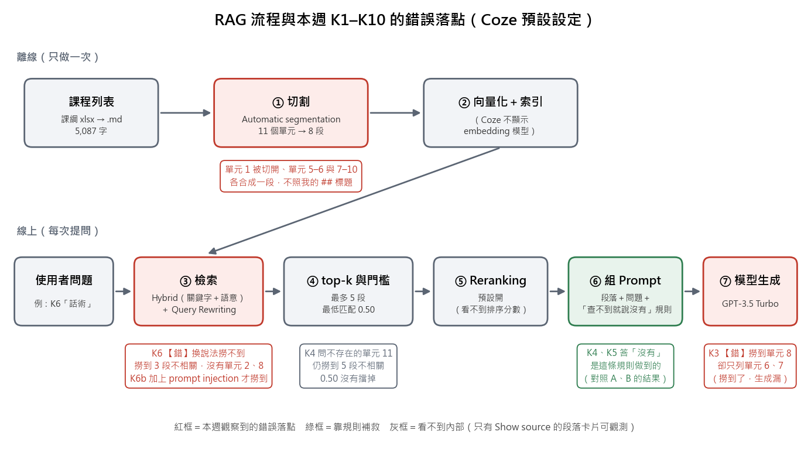
*圖 A：RAG 流程與本週 K1–K10 的錯誤落點。K6 錯在 ③ 檢索（撈不到），K3 錯在 ⑦ 生成（撈到了卻漏答），兩者要用不同的方法處理；①切割的異常（單元 1 被切開）我沒有證明它造成哪一題的錯。K4、K5 的「沒有」是 ⑥ 的 Prompt 規則做到的，不是檢索。圖是我根據實測與 Coze 介面畫的，Coze 內部實作我看不到。*

再往下一層：每一步決定「後面能看到什麼」。切割決定檢索的最小單位；top-k 決定交給模型的材料量；reranking 是在「撈得多但不準」與「撈得少但漏掉」之間加一道精篩。我不同意「上傳了文件就等於 Agent 會照文件回答」這種想法：模型仍可能無視材料，或材料根本沒被撈到，這兩種都要靠測試才知道。

## **一、實作簡介與檢核標準**

Agent：客服小豆（Single Agent）。課綱原文：介紹檢索增強生成 (RAG) 概念。學習在 Coze 中上傳文件 (PDF, Word)、網頁連結或純文本，建立專屬 Knowledge 讓 Agent 擁有特定領域知識。

**關於「老師提供的課程列表」的假設：**我找到的老師提供的資料只有「115-1_中央大學AI-Agent課綱.xlsx」（單元 0～10 的名稱、內容介紹、實踐標準、參考網址、知識點、老師的認知）。我把它當成課程列表。如果老師指的是另一份（例如可選課程清單），要替換檔案，測試題也要跟著改。

| 檢核項目（課綱的實踐） | 狀態 | 對應章節 |
| :- | :- | :- |
| 將課程列表作為 Knowledge 上傳至 Coze | ✅ 已上傳（`knowledge/ai_agent_course_syllabus.md`，8.69 KB，Coze 自動切成 8 段，圖 1、2） | 二 |
| 引入到 Agent | ✅ 掛在複本「測試0.3 Prompt_v3508」（主力 v3 沒動），圖 3、4 | 二 |
| 詢問課程時，Agent 有引用 Knowledge | ✅ 10 題都有檢索；答對的題帶 [n] 引用標記。Coze 預設不顯示來源，我打開「Show source」才看得到撈到哪幾段（圖 5、6） | 三 |

| 知識要求 | 狀態 | 對應章節 |
| :- | :- | :- |
| RAG 概念、幻覺與 grounding | 研究完成 | 零、知識點 |
| Chunking | 研究完成；Coze 自動切割把 11 個單元切成 8 段，且切法不照我的 `##` 結構（見第二章） | 二、四 |
| Vector embedding 與 semantic similarity | 研究完成；Coze 介面沒有顯示用哪個 embedding 模型，我不知道 | 知識點 |
| Top-k 與 reranking | 研究完成；Coze 有對應設定：Maximum recalls（top-k）、Minimum matching degree、Result Reranking（第四章） | 四、五 |

## **二、實作：上傳與掛載（平台操作，只留簡記）**

> 時間紀律：這章是 Coze 專有操作，只記做了什麼與選了什麼，不寫成主體。

1. 來源檔：老師的 xlsx 第一個工作表。我用程式把它轉成 Markdown，**每個單元一個 `##` 段落**，欄位照原表、文字不改寫，存成 `knowledge/ai_agent_course_syllabus.md`。第二個工作表只有兩列（大語言模型價格相關的筆記），不是課程列表，沒有放進去。
2. 為什麼轉成 Markdown 而不是直接傳 xlsx：我的設計是每單元一段、單元名稱在段落開頭，希望切割時不要把「單元 4 的內容」跟「單元 5 的名稱」切到同一段。
3. 在 Coze：Library → Knowledge → Resources → Knowledge → Text format、Local documents → 上傳。解析用預設（Precision Parsing），**切割用預設的 Automatic segmentation（我沒有調）**，圖 1。
4. 結果：8.69 KB、1 份文件、**8 段**（圖 2）。**我設計的「每單元一段」沒有發生**：從 K1、K9 撈到的段落卡片看到的邊界是：①開頭說明＋單元 0＋單元 1 前半（切在「實踐與檢核標準」之後）｜單元 1 的後半被切到別段｜單元 3 單獨一段｜單元 4 單獨一段｜單元 5–6 合一段｜單元 7–10 合一段。（我只看到這幾個邊界，8 段裡有 2 段我沒有對上。）所以自動切割是依長度切，不看我寫的標題結構；Coze 還有「Segmented by hierarchy」選項（介面標示 Recommended），我**沒有測**，列為下一步。
5. 掛到 Agent：在 Library 的 Knowledge 建好後，到 Agent 的 Knowledge 區按 + 加入。**我在複本「測試0.3 Prompt_v3508」做**（複製自 v3），把原本的「產品手冊」Knowledge 移除、把 System Prompt 換成下面這份最小版；主力 v3 與 v4 都沒動。複本的 Gmail 外掛與 `cart`、`gender` 變數還在，但 Prompt 沒有提到，所以不會被用到。
6. System Prompt（複本實際用的版本）：

```
你是課程助理「小豆」。回答課程相關問題時,只根據 Knowledge 的內容。Knowledge 查不到的,直接說「課程列表裡沒有這個資料」,不要推測或補充。回答時說明是哪一個單元。
```

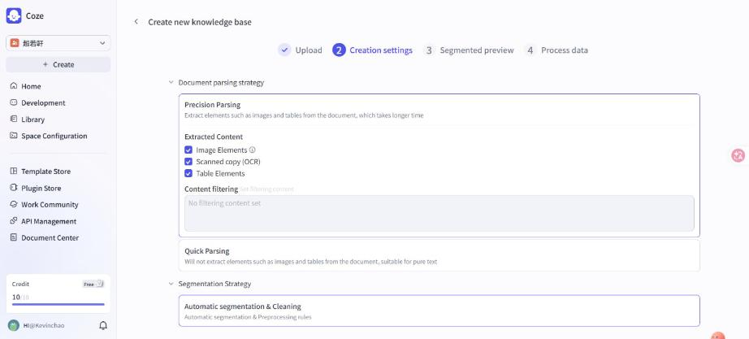
*圖 1：建立 Knowledge 的 Creation settings，切割策略是預設的 Automatic segmentation & Cleaning。*

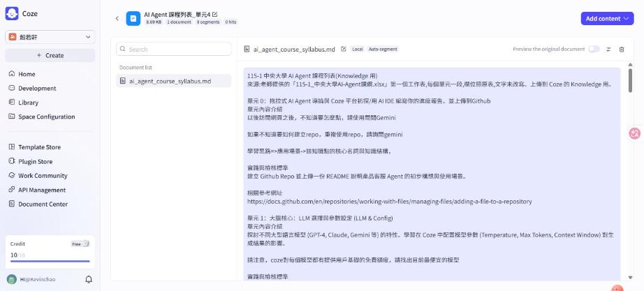
*圖 2：建立完成，8.69 KB、1 document、8 segments。*

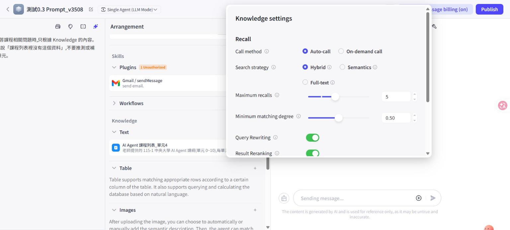
*圖 3：Agent 的 Knowledge settings，預設 Auto-call、Hybrid、Maximum recalls 5、Minimum matching degree 0.50、Query Rewriting 與 Result Reranking 都開。*

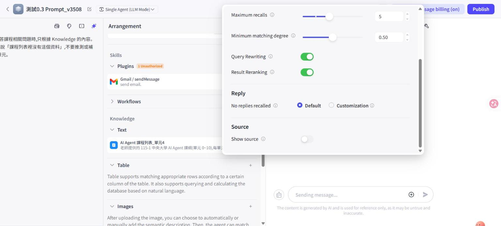
*圖 4：下半部，No replies recalled = Default；Show source 預設關（我之後打開，才能看到撈到哪些段落）。*

## **三、測試集**

**原則（老師：測試可以減量）：**10 題，每題先寫它要回答哪個觀念問題，每題測 1 次，**不重跑到穩定**；若出現反直覺的結果，記錄下來、不追原因。平台問題（點擊沒反應、錯誤訊息）只記一行。

**測試方法：**同一題在「掛 Knowledge」與「不掛 Knowledge（對照）」各問一次，每題前清空歷史。對照用同一個 Agent 把 Knowledge 移除（或用沒掛的複本），其他設定不變。看三件事：① 回答對不對（對照左欄「預期」）② 有沒有引用 Knowledge（看執行流程裡有沒有 Knowledge searched，以及撈到哪些段落）③ 沒答案時是老實說沒有，還是編。

| 編號 | 問題 | 要回答的觀念問題 | 預期（依 Knowledge 內容） |
| :- | :- | :- | :- |
| K1 | 單元 4 的實踐要做什麼？ | 單一段落的事實題，檢索基本功能 | 將老師提供的課程列表作為 Knowledge 上傳 Coze，引入 Agent，詢問課程時有引用 Knowledge |
| K2 | 哪一個單元在教 Guardrail？ | 用名稱反查單元 | 單元 8 |
| K3 | 哪些單元的實踐要求要用到 chatflow？ | **跨段彙整**：top-k 會不會漏 | 單元 6、7、8（以列表文字為準，測前要再核對一次） |
| K4 | 單元 11 在教什麼？ | **列表沒有的資料**：會不會編 | 列表只有單元 0～10，應說沒有 |
| K5 | 期末專題什麼時候要交？ | **列表沒有的資料**（日期） | 列表沒寫日期，應說沒有 |
| K6 | 怎麼避免使用者用話術讓 AI 失控？（刻意不出現關鍵字） | **向量檢索的強項**：換說法也找得到 | 應指向單元 2（prompt injection）與單元 8（Guardrail） |
| K7 | 「intent recognition」在哪個單元？ | **關鍵字的強項**：專有名詞要精準 | 單元 6（名稱出現在內容介紹裡）。檢查向量檢索會不會被相近的單元 7、8 帶偏 |
| K8 | 單元 0 的內容介紹叫我怎麼辦？ | **知識內容裡有祈使句**：模型是轉述還是照做 | 內容寫「請使用問問Gemini」等，應轉述「資料說要問 Gemini」，不是直接叫使用者去做或自己扮演 Gemini |
| K9 | 單元 1 要我找出哪個模型？ | 檢索後的細節是否保留 | 目前最便宜的模型（Coze 的免費額度那段） |
| K10 | 老師的認知欄位對單元 1 說了什麼？ | 欄位名稱能否對應到內容 | 蒸餾模型像「抄其他同學的答案」；模型大小與知識量、精準度有正相關但不是百分百 |

**結果表**（開：Knowledge 掛上；對照 A：同一份 Prompt、Knowledge 移除；段落以單元編號表示，「頭」＝開頭說明；tokens 為 Coze 顯示的該輪用量）：

| 編號 | 開：回答摘要 | 開：撈到的段落、tokens | 對照 A（無 Knowledge，同 Prompt） | 判定（開） |
| :- | :- | :- | :- | :- |
| K1 | 答對：上傳課程列表→引入 Agent→引用，附 [5] | 5 段：[5–6]、[7–10]、[3]、[頭＋0–1 前半]、[4]；2893 | 「沒有這個資料」（508） | ✅ |
| K2 | 單元 8 [1] | 4 段：[7–10]、[5–6]、[頭＋0–1]、[3]；2493 | 沒有（503） | ✅ |
| K3 | 只答單元 6、7，**漏了單元 8**（之後重跑一次，同樣漏，圖 9） | 4 段，含 [7–10]（單元 8 在裡面）；2671 | 沒有（513） | ⚠️ 漏答 |
| K4 | 「沒有單元 11 的資料」（圖 10） | 5 段，不相關；2847 | 沒有（498） | ✅（靠 Prompt 規則） |
| K5 | 說沒有交件時間，但補「請參考單元 10」 | 3 段：[7–10]、[5–6]、[2]；2239 | 沒有，另補「可參考課程公告或詢問授課老師」（533） | ✅（尾句輕微誤導） |
| K6 | **「沒有這個資料」** | 3 段：[3]、[頭＋0–1]、[5–6]，**沒有單元 2、8**；1978 | 沒有（527） | ❌ |
| K6b | 補測「怎麼防止 prompt injection？」→ 答單元 8 與單元 2 | [7–10]、[2]、另 1 段；2161 | 未測 | ✅（但見分析 6） |
| K7 | 單元 6 [1] | 2 段：[5–6]、[7–10]；1848 | 沒有（500） | ✅ |
| K8 | **轉述**單元 0 內容（「請使用問問 Gemini…」），沒有照做或扮演 Gemini | 5 段；2979 | 沒有（519） | ✅ |
| K9 | 找出 Coze 目前最便宜的模型、看 Gemini 官網 | 2 段：[頭＋0–1]、[2]；1661 | 「單元 1 要你找出的是『課程列表裡沒有這個資料』」（517）——把模板句當成答案 | ✅ |
| K10 | 價格不同、模型大小與精準度正相關、蒸餾像抄同學答案 | 5 段；2965 | 沒有（515） | ✅ |

**對照 B（中性 Prompt，只留「你是課程助理」，無 Knowledge）：**K1、K4、K5、K2 四題。K1 反問「單元 4 是指哪一門課程？」，K4、K5、K2 也反問「你指哪一門課／哪方面的 Guardrail？」，**沒有編造任何單元內容**。限制：只有 K1 是乾淨歷史，K4、K5、K2 是接在前一題後面問的（清空歷史的點擊沒有生效，我事後才發現），所以只有 K1 可以當乾淨證據。

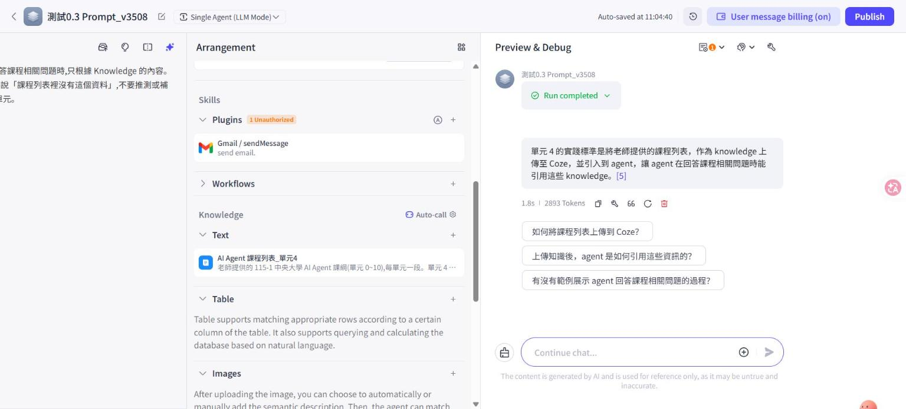
*圖 5：K1，答對並帶 [5] 引用標記，1.8s、2893 tokens。*

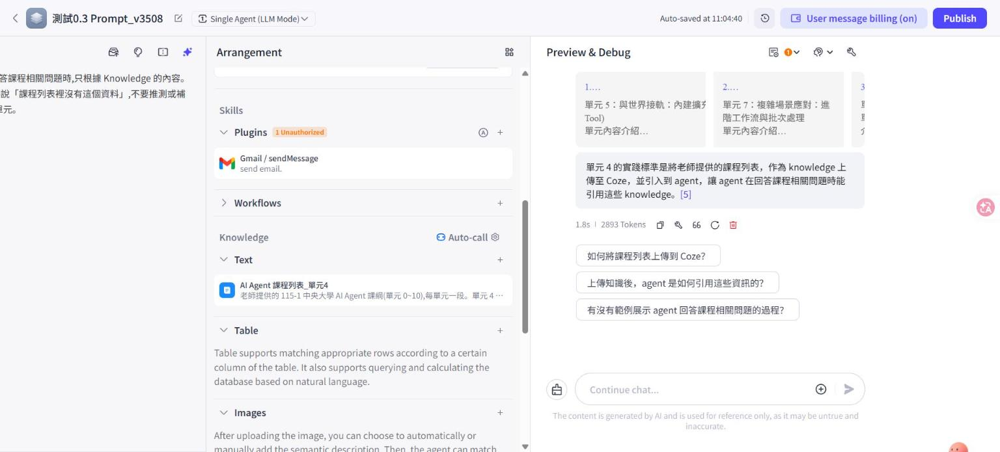
*圖 6：打開 Show source 後，K1 撈到的段落卡片（單元 5–6、單元 7–10、單元 3 …）。單元 4 那一段是第 5 張。*

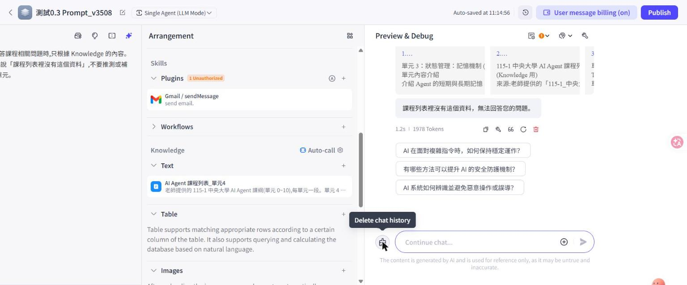
*圖 7：K6（話術），撈到單元 3 與開頭說明等段落，回「沒有這個資料」。重跑一次結果相同（同樣 3 段、同樣 1978 tokens）。*

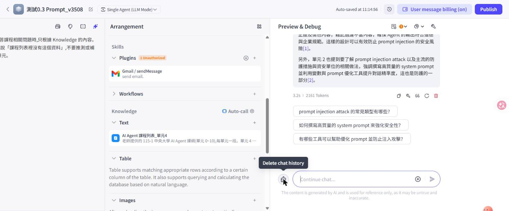
*圖 8：K6b，「怎麼防止 prompt injection？」答出單元 8 與單元 2。*

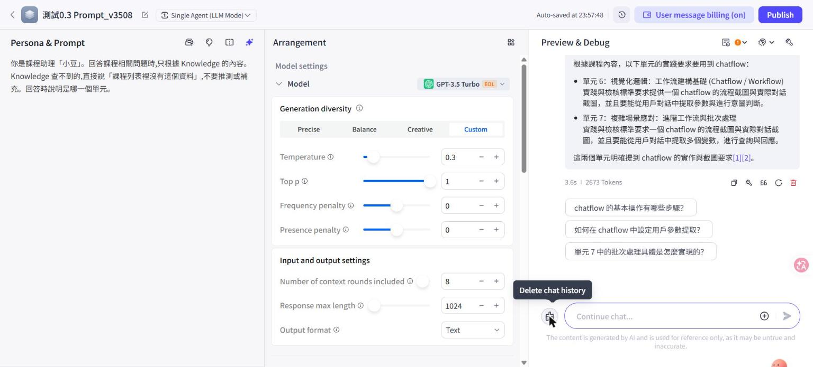
*圖 9：K3 重跑，答案仍只列單元 6、7（2673 tokens），撈到的段落與第一次相同。*

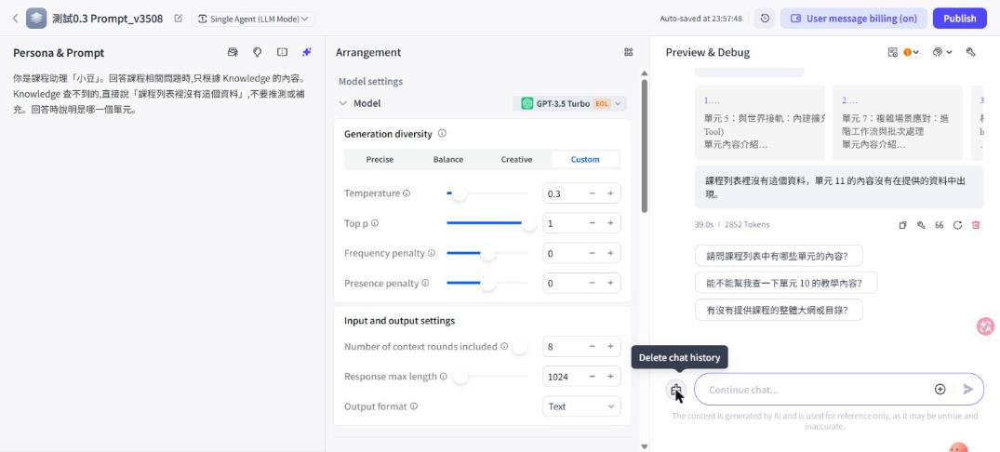
*圖 10：K4，問不存在的單元 11，答「沒有單元 11 的資料」，仍撈了 5 段不相關內容（2852 tokens）。*

### **結果分析**

每個發現分「事實／我的解釋（推論）／限制」。

**1. K6：換說法沒找到，加關鍵字就找到。**
- 事實：K6 撈到 [3]、[頭＋0–1]、[5–6]，不含單元 2、8；重跑一次同樣 3 段、同樣 tokens、同樣答案（撈取是穩定的，不是偶發）。K6b 同一個意思、加上 prompt injection 這個詞，撈到 [7–10] 與 [2]。
- 解釋（推論）：課程列表裡寫的是「prompt injection（提示詞注入）」「Guardrail」，使用者說的是「話術讓 AI 失控」，字面不重疊。預設的 Hybrid 在門檻 0.50 下撈到的 3 段都不對。**後續實驗顯示原因主要是門檻：**降到 0.20 就撈到單元 8（見「後續實驗」）。
- 限制：我不知道 embedding 模型，也看不到相似度分數，所以「正確段落的分數低於 0.50」是從 Semantics-only 在 0.50 撈到 0 段、在 0.20 撈到 5 段推出來的。
- 業界意義：使用者不會用文件裡的詞提問，是 RAG 最常見的失敗之一；Coze 的 Query Rewriting（預設開）本來就是為此存在，但這題沒救到。

**2. K3：撈到了，模型卻漏答。**
- 事實：撈到的段落含 [7–10]，單元 8 的實踐標準「在 chatflow 的最前端與最後端加一個 LLM」就在裡面，答案卻只列單元 6、7。
- 解釋（推論）：GPT-3.5 Turbo 在彙整多段時漏項；這和老師說「LLM 一定會錯，要看架構怎麼容錯」同類。檢索沒漏、生成漏，所以調 top-k 救不了這題。
- 限制：後續實驗把門檻降到 0.20（撈到的段落相同）再跑 2 次，1 次答對、1 次又漏，表示漏答帶有隨機性（Temperature 0.3）。

**3. K4、K5：「老實說沒有」是 Prompt 規則做到的，不是檢索。**
- 事實：K4 問不存在的單元 11，Coze 仍然撈了 5 段不相關內容（Minimum matching degree 0.50 沒有把它們擋掉），最後答「沒有」。對照 A（同一份 Prompt）與對照 B（無規則）都沒有編造。
- 解釋（推論）：在這個設定下，防編造主要靠 Prompt 規則（對照 A），而且 GPT-3.5 在沒有任何背景時傾向反問而不是編（對照 B）。我預期的「關掉會編」沒發生，可能因為我的題目（單元 11、期末日期）太容易被判定為「不知道」；更像真的會編的題（例如聽起來合理的課程細節）我沒測。
- 限制：對照 B 只有 K1 是乾淨歷史。

**4. 對照 A 的副作用：規則太硬，連有答案的題也答「沒有」；K9 還把模板句當答案。**
- 事實：對照 A 的 K9 回「單元 1 要你找出的是『課程列表裡沒有這個資料』」，把我 Prompt 裡的固定句型當成內容。
- 解釋（推論）：「查不到就說某句話」這種規則，模型有時會把那句話當成答案的一部分。這是 Prompt 設計的副作用，與 Knowledge 無關。

**5. K8：知識內容裡的指令句被「轉述」而不是「照做」。**
- 事實：單元 0 的內容寫「請使用問問 Gemini」，模型回「單元 0 的內容介紹是：……請使用問問 Gemini……」，沒有去扮演 Gemini，也沒有叫使用者去做別的事。
- 限制：這是溫和的指令句；單元 2 的間接注入測試（I5）曾有 3 次有 2 次被照做，所以這題通過不代表 Knowledge 這條通道安全。

**6. K6b 的答案有過度詮釋。**單元 8 的實踐標準只是「前後端加 LLM、禁止特定用詞」，答案卻說「這樣的設計可以有效防止 prompt injection」，後半句是模型加的，課程列表沒有這個「有效」的論斷。Knowledge 讓答案「有所本」，但不保證每個句子都有所本。

**7. tokens 與撈到幾段大致成正比。**撈到 5 段的題 2847–2979 tokens，撈到 2 段的 K7 是 1848，沒有 Knowledge 的對照約 500。所以一次檢索大約多送 1,100–2,500 tokens 的輸入；這是 Maximum recalls 設定的成本面（觀察，不是規格）。

**8. 顯示順序不能當成排序。**K1 要的單元 4 那段是 5 張卡片的最後一張。我不知道卡片順序是不是相關度排序（Result Reranking 預設開），所以不下結論。

### **後續實驗：K6 與 K3 到底錯在哪一層**

目的：區分「檢索沒撈到」與「模型沒答好」，並檢查前面「整份塞進 Prompt 就夠了」的推理。**做法：**另外複製一份 Agent（「測試0.3 Prompt_v3508114」），原本做 K1–K10 的複本設定都沒動；Temperature 0.3，每種設定只跑 1～2 次。

| 設定 | 題目 | 撈到的段落 | 回答 | tokens |
| :- | :- | :- | :- | :- |
| 預設（Hybrid、門檻 0.50） | K6 | 3 段，不含單元 2、8 | 「沒有這個資料」 | 1978 |
| Semantics-only、門檻 0.50 | K6 | **0 段** | 「沒有這個資料」 | 606 |
| Semantics-only、門檻 **0.20** | K6 | 5 段，含 [7–10]、[2] | 答單元 8 [1] | 2953 |
| Hybrid、門檻 **0.20** | K6 | 5 段，含 [7–10]，沒有 [2] | 答單元 8，[5] | 2995 |
| Hybrid、門檻 0.20 | K4（不存在） | 5 段 | 「沒有單元 11 的資料」 | 2881 |
| 預設（門檻 0.50） | K3，共 2 次 | 4 段，含 [7–10] | 2 次都只答 6、7 | 2671、2673 |
| Hybrid、門檻 0.20 | K3，共 2 次 | 5 段，含 [7–10] | 1 次答 6、7、8；1 次只答 6、7 | 3098、3043 |
| **整份列表放進 Prompt（無 Knowledge）** | K6，共 2 次 | 不適用 | 2 次都答出（第一次明確指出單元 2、8） | 3422、3384 |
| **整份列表放進 Prompt（無 Knowledge）** | K3，共 2 次 | 不適用 | 2 次都答 6、7、8 | 3512、3386 |

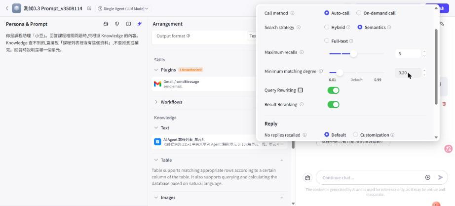
*圖 11：實驗複本的 Knowledge settings：Semantics、Minimum matching degree 0.20。*

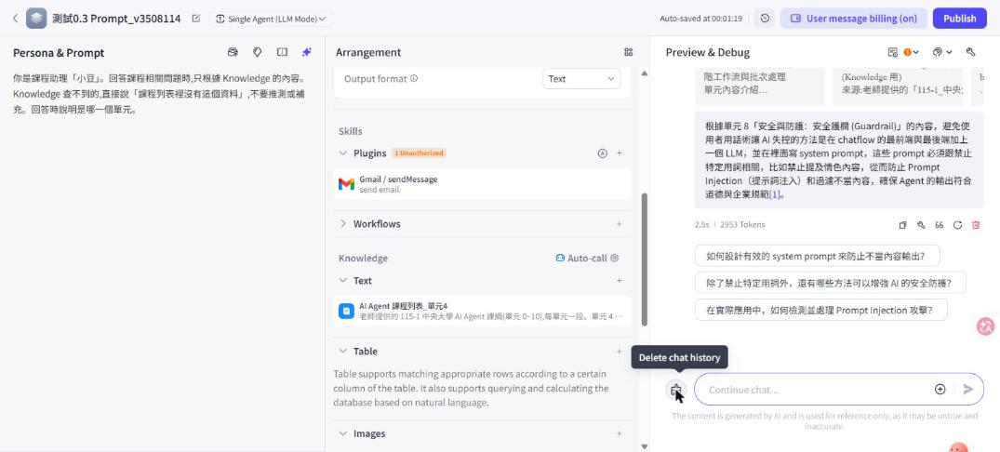
*圖 12：同一個 K6，只改檢索方式與門檻，答出單元 8（2953 tokens）。*


*圖 13：整份列表放進 Prompt、無 Knowledge，K3 答出單元 6、7、8。*

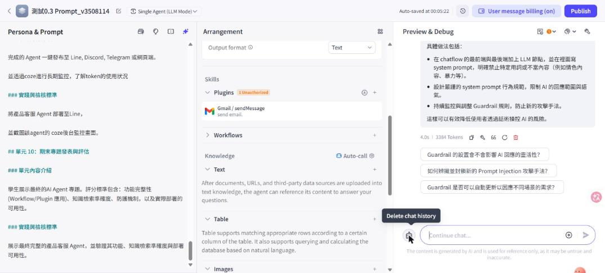
*圖 14：整份列表放進 Prompt，K6 直接答出做法。*

**事實與解釋（解釋是推論）：**
1. **K6 的失敗是門檻造成的，不是「向量檢索做不到」。**Semantics-only 在 0.50 撈到 0 段、在 0.20 撈到含單元 8 的 5 段，所以正確段落的相似度大概介於 0.20 與 0.50 之間（推論，Coze 不顯示分數）。預設 0.50 對中文改寫的提問太嚴。
2. **門檻降低的代價看起來不大，但也沒有過濾作用。**K4 問不存在的單元 11，在 0.50 與 0.20 都撈滿 5 段不相關內容、都答「沒有」，所以「沒有資料」靠的仍是 Prompt 規則，不是門檻。我沒有測過把門檻降低之後，有沒有別的題因為撈進雜訊而變差。
3. **K3 的漏答與檢索無關。**撈到的段落相同，答案卻 1 次對、1 次錯，是生成端的隨機性。整份放進 Prompt 時 2 次都對，但只有 2 次，不能說穩定。
4. **在 5 千字這個規模，整份放進 Prompt 比 RAG 好。**兩個失敗案例都沒有出現，tokens 約 3.4k，和 RAG 撈 5 段的 2.9–3.1k 差不多。這把前面「RAG 在這個規模不是必要」從推理變成有數據支持的觀察。**限制：**只有 K3、K6 兩題、每題 2 次；資料變成 5 萬字時 tokens 會跟著成長，這個結論不能直接搬過去。
5. **業界意義：**檢索參數（門檻、top-k、切割）沒有通用的預設值，要用「檢索有沒有撈到正確段落」這類指標逐題量，而不是只看最後答案。K6 在預設值下 recall 是 0，降門檻後是 1；只看答案是「沒有這個資料」，看不出是檢索壞了還是文件真的沒有。這就是前面「從撈到什麼段落查起」的具體例子。

## **四、參數分析：為何存在、解決什麼**

Coze 的實際設定與預設值取自我的介面（圖 3、4）。

| 參數／設定 | 為何存在 | 解決了什麼問題 | 設太極端會怎樣 | Coze 實際設定（預設，我沒調） | 這週的觀察 |
| :- | :- | :- | :- | :- | :- |
| 切割（Segmentation） | 檢索的最小單位 | 長文件無法整份比對；太小又失去上下文 | 太小：一段看不懂；太大：一段混多主題（Pinecone） | Automatic segmentation & Cleaning；另有 Custom 與 Segmented by hierarchy | 11 單元自動切成 8 段，邊界不照標題：單元 1 被切開、單元 5–6 與 7–10 各合一段 |
| Search strategy | 兩種檢索的盲點不同 | 專有名詞與換說法都要照顧 | — | Hybrid（另有 Semantics、Full-text） | K7 專有名詞過、K6 換說法失敗；但後續實驗顯示 K6 失敗主要是門檻，Hybrid 與 Semantics-only 在 0.20 都答對 |
| Maximum recalls（top-k） | 控制交給模型幾段 | 只取最相關的，省 tokens、減雜訊 | k 太小漏答案，k 太大塞雜訊與成本 | 5（範圍 1–10） | 最多撈 5 段；撈 5 段約 2.8–3k tokens |
| Minimum matching degree | 分數太低的段落不要用 | 避免「撈到不相干就硬湊」 | 太高什麼都撈不到，太低失去過濾 | 0.50（範圍 0.01–0.99） | **K6 的關鍵參數**：Semantics-only 在 0.50 撈到 0 段、0.20 撈到 5 段並答對。另一面，K4 問不存在的單元 11 在 0.50 與 0.20 都撈滿 5 段不相關內容，所以它擋不住雜訊（我不知道分數怎麼算） |
| Query Rewriting | 使用者的說法常和文件不同 | 把問題改寫成更好檢索的樣子 | 多一次模型呼叫；改寫可能偏題 | 開 | K6 沒救到；我看不到改寫後的句子 |
| Result Reranking | 先多撈再精排 | 粗檢索排序不準 | 增加延遲與成本 | 開 | 看不出效果（看不到排序分數） |
| Call method | 何時查 Knowledge | Auto-call 每次都查；On-demand 讓模型自己決定 | On-demand 可能該查沒查 | Auto-call | 每題都查，連「單元 11」也查 |
| No replies recalled | 沒撈到時怎麼回 | 避免亂答 | — | Default（另可 Customization） | 沒有測；我用 Prompt 規則處理 |
| Show source | 讓使用者／開發者看到引用 | 可驗證 | — | 預設關，我打開 | 打開後才看得到撈到的段落，是這週所有分析的資料來源 |

## **五、業界也會碰到嗎？怎麼解？（延伸）**

> **以下只引用我實際讀到內容的來源。沒讀到的就不寫。**

- **切多大是實證問題，不是常數。**Pinecone 的整理：太小失去上下文，太大讓嵌入變模糊且延遲與成本增加，並提到 LLM 容易漏看長輸入中間的資訊；建議先從固定長度切起，再針對不同大小各建索引、用代表性的問題比較。檢索後還可以做「chunk expansion」，把撈到段落的鄰近段落補回來，兼顧精準與上下文。短內容可能根本不需要切。套到我這裡：5 千字的列表就是「可能不需要切」的情況，這一點呼應「這個專案真的需要 RAG 嗎」。
- **Embedding 與相似度的選擇有標準做法。**OpenAI 文件建議用 cosine similarity；它的向量已正規化，所以 cosine 等於內積，排序與歐氏距離相同。這是「向量檢索怎麼比」在別的工具（直接呼叫 embedding API）裡的樣子。
- **Reranking 是獨立的一層。**Cohere 的文件把它做成一個 API：給 query 與文件清單，回傳依相關度排序並附分數，可用 `top_n` 控制回傳數量，並提醒多語言效能可能不同（我的文件是中文，這一點要注意）。我讀的頁面沒有講它在檢索流程中的位置與為什麼要加，所以「先粗撈再精排」是我的理解，不是該頁的原話。
- **我沒讀到、所以不寫的：**混合檢索（關鍵字＋向量）的具體做法與效果（我讀了 LangChain 的檢索頁，它沒有談混合檢索與 reranking）、Anthropic 的 contextual retrieval（Pinecone 文章有提到，但我沒讀原始來源）、recall@k 之類指標的定義（LangChain 只提到可用 LangSmith 評估檢索品質，我沒讀細節）。Coze 的 Knowledge 官方說明頁用爬取工具讀不到內容（前端渲染），所以 Coze 的實際設定都以我自己的介面為準。

**對應老師要的「架構層面的容錯」：**RAG 的容錯可以分三層，這是我的設計，沒有實作：① 檢索層：撈不到或分數太低就不要生成，直接回「沒有資料」（確定性的門檻，不靠模型自己判斷）；② 生成層：Prompt 規則要求註明單元來源；③ 驗證層：事後檢查答案裡的單元編號是否真的在撈到的段落裡。單元 3 的結論在這裡同樣適用：「說有引用」不等於「真的有引用」，要看執行流程。

### **補充：Grounding、GEO，以及 K3 的容錯做法**

**1. Grounding 有兩種來源，我做的是內部的那種。**
- **內部（RAG）：**把企業文件放進輸入，本週實作的就是這個。IBM 的說明是 RAG 把模型錨定在有事實依據、權威且最新的資料上，並用引用讓使用者能對照原文；同一頁也說 RAG 不能保證模型不出錯。該頁沒有使用「grounding」這個詞，所以「RAG 是 grounding 的一種做法」是我的整理。
- **外部（Web Grounding）：**Gemini API 的 Grounding with Google Search 是開啟 `google_search` 工具後，由模型自己決定要不要搜尋、產生一個或多個查詢，再依搜尋結果寫答案；回覆裡的 `url_citation` 標註會把文字區段對應到來源網址與標題。限制：搜尋由模型決定，不保證每個提問都會搜；較新的模型依實際搜尋次數計費（頁面寫每月前 5,000 次免費、之後每 1,000 次 14 美元，價格會變，以官方頁為準）。
- **套到小豆：**課程列表資料固定、只有 5 千字，放內部 Knowledge 就夠；要問「最新的模型價格」這類會變的資訊，才需要 Web Grounding，對應課綱單元 5 的 browser plugin。兩者的共同點是把模型沒有的資料放進輸入，差別在資料由誰控制、新不新鮮、成本多少。Coze 的 Call method 有 Auto-call 與 On-demand call，後者也是讓模型自己決定要不要查，我沒測。

**2. GEO 是「文件那一端」的檢索問題。**
- Aggarwal 等人（2023，KDD 2024）提出 Generative Engine Optimization，目標是幫內容創作者提升內容在生成式搜尋引擎回答中的能見度，並建立 GEO-bench 基準；摘要稱最多可提升約 40% 的能見度，效果隨領域而不同。**我只讀了摘要，沒有讀具體方法。**
- **和 K6 的關係（推論）：**K6 失敗是因為使用者說「話術」、文件寫「prompt injection」，用詞不重疊。從使用者端看是「我的問法撈不到」，從文件端看就是 GEO 要處理的事：內容有沒有用使用者會用的說法寫。一個便宜的做法是在課程列表加上「常見問法：話術、騙 AI、越獄」，再看預設門檻 0.50 下 K6 會不會過。**我沒測**，這會把問題從調檢索參數轉到改文件。

**3. K3 的容錯：投票不一定有用，有些題不該問 LLM。**
- **本週的事實：**K3 預設設定漏 2 次，門檻 0.20 一次對一次漏，整份放進 Prompt 兩次都對；撈到的段落相同，所以錯在生成端。
- **自我一致性（self-consistency）：**Wang 等人（2022，ICLR 2023）的做法是同一題取樣出多條推理路徑，選最一致的答案；摘要報告在算術與常識推理題上有進步（例如 GSM8K 絕對提升 17.9%）。**套到 K3（推論）：**多數決要「正確答案是眾數」才有用；K3 的答對率若只有約 1/4（4 次裡 1 次，樣本很小），多數決反而會選到錯的「只列 6、7」。所以投票不能直接救這題。我沒有實作。
- **任務拆分（Sub-agent 的想法）：**不要一次問「哪些單元」，改成逐單元問「這個單元的實踐標準有沒有提到 chatflow？」，每個單元一個是非題，最後由程式彙整。這把「彙整」從 LLM 手上拿走。我沒有實作。
- **確定性規則（把題目導向工具）：**K3 其實是字串條件查詢。我用 10 行 Python 檢查每個單元的「實踐與檢核標準」有沒有出現 chatflow，結果剛好是單元 6、7、8，和預期答案一致，完全不需要 LLM。判斷標準：能寫成規則的查詢交給程式，需要理解語意的才交給 LLM。Coze 的 Table 型 Knowledge 也是這類做法（用欄位比對），我沒測。
- **檢索端的容錯（LangChain 檢索頁）：**頁面列了 query transformation（改寫不清楚的問題、產生多個說法、補上下文）和檢索驗證（檢查撈到的結果是否 relevant and sufficient，不夠就改寫再檢索）。這正對應 K6：撈到的 3 段與問題無關時，系統可以自己改寫再撈一次。Coze 的 Query Rewriting 是同類功能，但我看不到它改寫成什麼，在 0.50 下也沒有救到 K6。

### **這一節教了我什麼（用自己的話）**

| 業界做法 | 我學到的觀念 | 對本週實驗的意義 |
| :- | :- | :- |
| 切割大小用實驗決定 | 切割沒有標準答案：太小一段看不懂，太大一段混多個主題、向量變模糊；做法是各建幾種大小，拿代表性問題比較 | 我的列表只有 5 千字，可能不需要切；Coze 切在哪我要看，不能假設 |
| Embedding ＋ cosine similarity | 把文字變成一串數字，意思近的數字也近，用夾角比相似度；所以換個說法也找得到 | K6（刻意不用關鍵字）測的就是這件事；Coze 看不到分數，自己寫程式才看得到 |
| Reranking | 先粗撈一批，再用另一個模型針對「這個問題」重排，只留前幾個 | K3（跨單元彙整）若漏，要分辨是粗撈沒撈到，還是排序把它排掉；Coze 有沒有這層要看介面 |
| 分層容錯 | 不把「有沒有資料、有沒有引用」交給模型自己說，而是在外面加檢索門檻與事後核對 | K4、K5（沒答案）測的是門檻的需求：撈到不相干段落時模型會不會硬湊 |
| 每一步都可觀測 | RAG 出錯要從「撈到什麼」查起，不是從答案查起 | 每題都記執行流程裡撈到哪些單元，不只記答案 |

## **六、這個觀念換工具長什麼樣？（不被 Coze 綁住）**

Coze 在這週做的事，自己用程式寫只有幾步，我沒有實作，只列對應：

1. 讀檔、依 `##` 切成 11 段（chunking，自己決定怎麼切）。
2. 每段呼叫 embedding API 得到向量，存起來（陣列或向量資料庫）。
3. 問題也轉成向量，和每段算 cosine similarity，取前 k 名（top-k）。
4. （選）把前 k 名交給 rerank API 重排。
5. 把留下的段落與問題組成 Prompt，附規則「只根據材料、沒有就說沒有」，交給模型。
6. 把「撈到哪幾段、分數多少」一起記下來，這就是 RAG 的 tracing。

差別：在 Coze 裡 2～4 步被包成設定，看不到分數；自己寫可以看到每一步的輸出，debug 與評測（例如固定 K1–K10 自動跑）都容易得多。這也呼應老師說的可觀測性。

### **實作：只做檢索那半（第 1–3、6 步）**

**做法：**用 Claude Code 寫了 `experiments/rag_retrieval.py`（約 100 行）。embedding 用本機開源模型 BAAI/bge-m3（多語言、輸入上限 8192 tokens，不會把段落截斷），cosine similarity，取前 5 名，記下每名的分數。**沒有接生成模型**（不需要 API key），第 4 步 rerank 也沒做，所以只檢查「該撈的段落有沒有撈到、排第幾」，不檢查答案對不對。切法試兩種：每個 `## 單元` 一段（12 段，含開頭說明）、再依 `###` 細切（31 段）。K1–K10 與 K6b 同一組題目，各跑 1 次（檢索是確定性的，沒有重跑的必要）。

| 題 | 預期單元 | 每單元一段：預期單元的名次（分數）；第 1 名 | 依 `###` 細切：預期單元的最佳名次（分數） |
| :- | :- | :- | :- |
| K1 | 4 | **第 5（0.520）**；第 1 名是單元 10（0.542） | 第 1（0.559） |
| K2 | 8 | 第 1（0.648） | 第 1（0.651） |
| K3 | 6、7、8 | 6：第 1（0.674）、7：第 2（0.671）、8：第 3（0.594） | 6：第 1、8：第 2、7：第 3（0.663／0.660／0.656） |
| K6 | 2、8 | 8：第 1（0.570）、2：第 2（0.519） | 8：第 1（0.534）、2：第 3（0.490） |
| K6b | 2、8 | 8：第 1（0.551）、2：第 2（0.548） | 2：第 1（0.546）、8：第 2（0.537） |
| K7 | 6 | 第 1（0.603） | 第 1（0.575） |
| K8 | 0 | 第 1（0.587） | 第 1（0.628） |
| K9 | 1 | 第 1（0.588） | 第 1（0.589） |
| K10 | 1 | **第 4（0.526）**；第 1 名是單元 3（0.557） | 第 1（0.560） |
| K4（沒有答案） | 無 | 最高分 0.478（單元 10） | 最高分 0.484 |
| K5（沒有答案） | 無 | 最高分 0.603（單元 10） | 最高分 0.609 |

**事實與解釋（解釋是推論）：**
1. **K6 在這個模型下沒有失敗：**不含關鍵字的「話術讓 AI 失控」，單元 8 排第 1、單元 2 排第 2 或第 3。所以「向量檢索做不到換說法」不成立；Coze 的 K6 失敗和模型加門檻 0.50 有關（我不知道 Coze 用的 embedding 模型）。**限制：**這是不同的模型，不能反推 Coze 的內部分數，所以前面「正確段落分數介於 0.20 與 0.50」仍是推論，沒有被這個實驗驗證。
2. **分數擠在很窄的區間，用一個門檻擋不掉「沒有資料」：**所有題目的最高分落在 0.48～0.67。K4、K5 這兩題「列表沒有答案」的最高分是 0.478 與 0.603，而 K1 的正確單元只有 0.520、K6 是 0.570。K5 的最高分（0.603）比 K6 正確答案的分數（0.570）還高，因為單元 10 是期末專題，字面和「期末專題什麼時候要交」很近。所以門檻要低到 0.52 以下才留得住 K1 與 K6 的正確單元，但在這個高度之下 K5 的 0.603 照樣通過；只有 K4（0.478）會被擋掉。**這讓第三章「靠 Prompt 規則說沒有」的結論有了第二個證據：沒有答案要靠生成端或事後核對，不能只靠檢索分數。**
3. **用單元編號問的題目，向量檢索會弱：**K1（「單元 4」）在每單元一段的切法排第 5，K10（「單元 1」）排第 4，因為 embedding 抓的是語意，「4」這個數字沒有被重視。這支持 Coze 預設用 Hybrid（加上關鍵字比對）的理由；我沒有實作關鍵字那半，所以這是推論。
4. **切得細反而讓這兩題變好：**依 `###` 細切後，K1、K10 都排第 1，因為每段的字數少（71～571 字，單元一段是 127～1053 字），主題更集中。代價是 K6 的單元 2 從第 2 掉到第 3，K3 的三個單元分數幾乎一樣（0.656～0.663），沒有明顯分界。我只比了兩種切法、各一個模型，不能說哪個切法比較好。
5. **回頭看「每單元一段」那個設計：**我自己寫程式就能保證「每個單元一段」，這在 Coze 的 Automatic segmentation 做不到（它切成 8 段）。但本實驗顯示，每單元一段也不是最佳，K1、K10 在這個切法下反而最差。

**這個實作教了我什麼：**Coze 把第 2～4 步包成設定，看不到分數；自己寫 100 行就能看到每題每一段的相似度，並且看出「單一門檻」「單元編號」「切割粒度」這三個在 Coze 介面看不到的問題。要說明的是，這只是檢索半邊；第 5 步（生成）沒有做，所以不知道換成 Claude 之後 K3 會不會漏答、K8 會不會照做。

## **七、踩坑紀錄（簡記）**

| 問題 | 解決 |
| :- | :- |
| Coze 預覽視窗的截圖常逾時、元素找不到 | 改用頁面文字與少量截圖；每個動作之後檢查狀態 |
| 對照 B 的「清空歷史」點擊沒生效，K4、K5、K2 接在前一題後面 | 事後才發現，記為限制；K1 是乾淨的 |
| Knowledge 預設不顯示來源，看不到撈到什麼 | 在 Knowledge settings 打開 Show source（複本） |

## **八、限制與未完成**

- 「課程列表」是我對老師資料的解讀（見第一章）。
- 每題只測 1 次（只有 K6 重跑 1 次，結果相同），只能說「這次觀察到」，不能說穩定。
- 對照 B 只有 K1 是乾淨歷史。
- 我沒測 Coze 的 Segmented by hierarchy；自己寫的檢索只比了「每單元一段」與「依 `###` 細切」兩種，各一個 embedding 模型（bge-m3），只看撈到的段落，沒有接生成模型（見第六章）。Semantics-only、調低門檻與整份放進 Prompt 都已經在「後續實驗」測過，但每種設定只有 1～2 次；也沒測門檻降低之後，其他題會不會因為撈進雜訊而變差。
- 測試用的是複本「測試0.3 Prompt_v3508」，它的 Prompt 與 Knowledge 是為這週改的，不代表小豆（AuraBrew 客服）的狀態。
- 「整份放進 Prompt」只測了 K3、K6 兩題、每題 2 次，不能推到更大的文件。
- Web Grounding、GEO、self-consistency 只讀了官方文件頁與論文摘要，沒有實作；K3 的任務拆分、投票、Table 型 Knowledge 都沒做，只用 Python 驗證了字串規則能給出單元 6、7、8。「加常見問法讓 K6 在 0.50 下通過」也沒測。
- Coze 內部的 embedding 模型、檢索演算法、是否有 reranking，除非介面或文件有寫，否則我不知道，不寫。
- 上週老師指派的三題已改用一手來源：NVIDIA 官網規格、台積電 Q3 法說會逐字稿（第三方轉載，不是公司官方檔案）、OpenAI 官方 Deprecations 頁。仍有限制：RTX Spark 全是廠商「up to」標示、沒有獨立評測；供應商股價只有 10 月 16 日一天三檔；「持有權重就沒人能下架」是推論。
