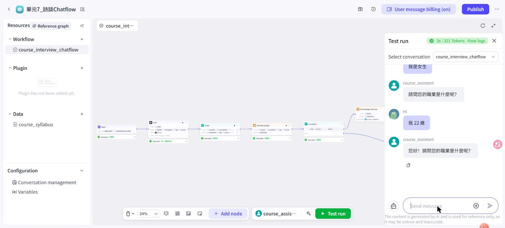
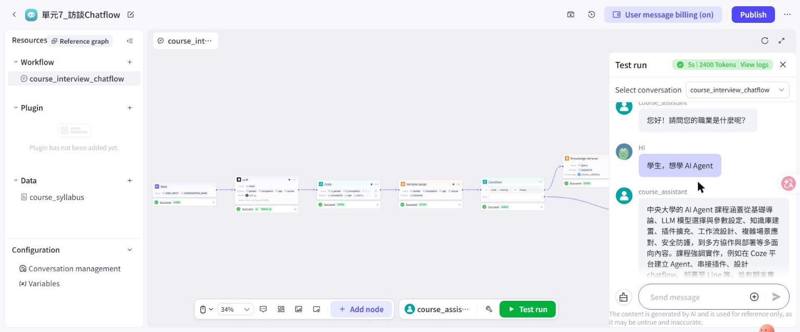
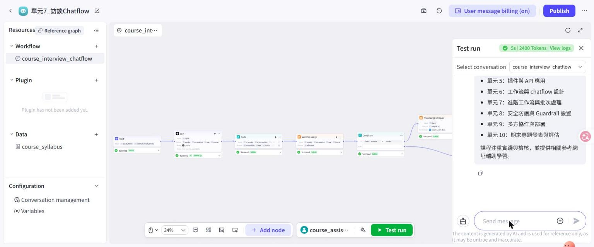
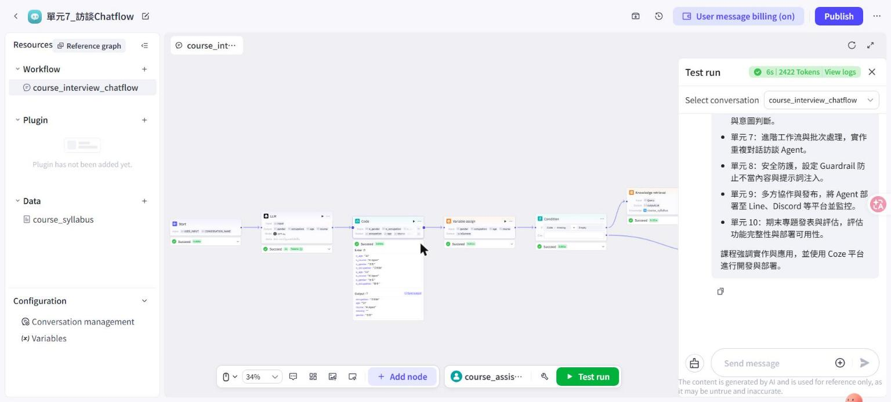
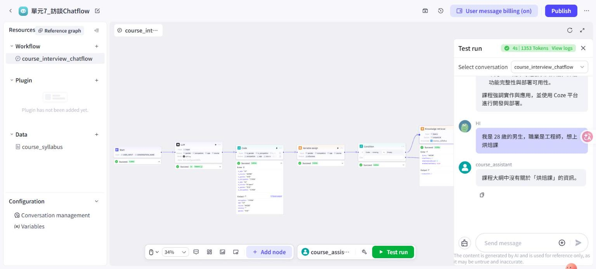
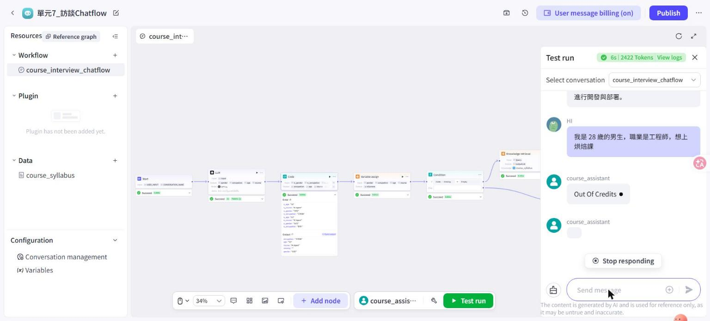
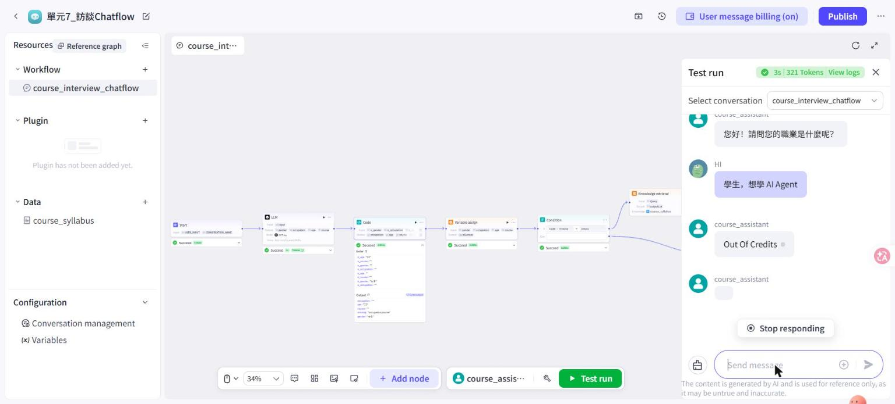

# Agent 的記憶：用變數跨輪記住使用者、缺欄位就追問（單元 7）學習文件

專案：客服 Agent（AuraBrew 模擬產品，假資料，老師允許）　姓名 / 學號 / 班級：趙若軒 / 113801517 / 生醫三　Repo：https://github.com/hehehe2306/auraBrew-support-agent

**期末專題目標：**做一個「美股 IBKR 個人財務分析助理」Agent——讀取 IBKR 模擬帳戶的持倉與餘額，結合利率、匯率等宏觀資料，解釋保證金與利差帶來的風險，並稽查自己算出的數字有沒有錯；只做分析與稽查，下單與槓桿水位交給人決定。本週的單元 7 對應其中「資料不齊就先問、齊了才往下算」：帳戶欄位缺了不能猜著算，這和本週的「缺欄位就追問」是同一個結構。

## 想問老師

1. **Coze 要下架（老師在單元 6 的註解）：**單元 8（Guardrail）和單元 9（發布與 Token 監控）的實作，還需要在 Coze 做嗎？還是用 Claude Code 或自己的程式做？我的想法是只做到能回答課綱的觀念問題，其餘轉到自己的程式。

## 結論摘要

**關鍵實驗：**我用 Coze Chatflow 做一個「會記住使用者、缺欄位就追問、補齊才查知識庫」的訪談 Agent，並用 5 次對話輸入驗證記憶與回應（附圖 1）。**反直覺的坑：**第 2 輪模型的回答在「記憶有效」和「記憶失效」時看起來一樣，所以只看最終回答會被騙；我必須展開 Code 節點的輸入輸出（`o_gender="女生"`）才拿到證據（附圖 4）。**最終結論：**記憶不是模型自己的功能，而是「存進持續變數＋一段固定的合併規則」；這個設計在 5 次輸入裡讀寫都正確（含一次使用者更正舊值），課程查不到時回應也沒有編造，但每種情況只有一組輸入，**穩定性沒有證明**。成本上，知識庫那條路約是追問那條路的 4～7 倍（每輪 1353～2422 對約 320 Tokens）；而且「查不到時不編造」靠的是回應 LLM 自己判斷檢索內容無關，因為知識庫並沒有回空（撈到 2 個無關片段），這是下一個要加強的地方。

## 零、概念

課綱要我學三件事：記憶（memory）、知識庫（knowledge）、重複對話的訪談流程。

**1. 記憶是什麼？** 推理：LLM 本身每次呼叫都沒有上一輪的狀態，所以「記住」只能是我把資訊存到某個地方、下一輪再讀回來。Coze 有兩種變數，**這是我讀變數設定頁的說明文字推的**，官方文件我沒另外查：App variable 的說明是「每次新請求都初始化成預設值」，所以不能拿來跨輪記；User variable 的說明是「持續儲存」，我用它。實測上，User variable 在第 2 輪讀到了第 1 輪的值（附圖 4），這點是實測的。

**2. 這是哪一種記憶？** 課綱單元 3 把記憶分成三種：對話輪數（context of round）、特定重點（variable）、重複行為（table）。對照我的流程：我用的是**「特定重點」型**——只把性別、職業、年紀、課程四個欄位存進變數；抽取 LLM 看的是使用者「最新一句」，沒有開對話歷史（對話輪數型沒用）；也沒有用資料表（重複行為型沒用）。這個選擇的代價是：模型不會記得使用者前面說過什麼別的話，只記得被抽出來的四個欄位。

**3. 訪談流程的本質。** 這其實是 NLP 常說的「槽位填充（slot filling）」：預先定好要收集的欄位，每輪抽欄位、合併、檢查哪個還空著，空著就問，全部齊了才進下一步。

**4. 知識庫（RAG）在這裡的角色。** 欄位齊了以後，用「想上的課」當查詢字串去知識庫找資料，再讓 LLM 只依檢索結果回答。這段沿用單元 4 學過的 RAG 觀念；本週的新問題是「查到的內容有沒有被忠實回答」：我把兩次回覆對照課綱原檔核對過，沒有編造，但漏了單元 2、3（見第二章）。

**IPO（老師的檢查方法）：**

|  | 抽取 LLM | Code 合併節點 | 條件判斷 | 追問 LLM |
| :- | :- | :- | :- | :- |
| Input | 使用者本輪原話 | 本輪抽到的 4 欄 + 記住的 4 欄 | Code 輸出的 missing | missing（缺哪些） |
| Process | LLM 依 Prompt 判讀，沒提到回空字串 | 本輪非空就覆蓋，否則保留舊值；算出缺哪些 | missing 是否為空 | LLM 在缺的欄位裡挑一個問 |
| Output | 4 個字串欄位 | 合併後 4 欄 + missing | 走「查知識庫」或「追問」 | 一句追問 |
| 怎麼驗證 | 對照原話（單元 6 做過） | 看節點輸入輸出（附圖 4、8） | 看實際走哪條線（輪 1、2 走追問；輪 3、A 走知識庫） | 只問缺的、不重問已知的（輪 1、2 都只問職業） |

## 一、實作簡介與檢核標準

**課綱檢核標準：**

1. 一個 Chatflow 的流程截圖與實際對話截圖。
2. 使用者說話時，LLM 嘗試提取性別、職業、年紀、想上什麼課，並填回 variable。
3. 任一 variable 沒填妥，開啟一個 LLM 跟使用者對話，要求填妥。
4. 四個參數都滿足，查詢 knowledge，把結果交給 LLM 回應。

**我的設計與「為何存在」（只留和觀念有關的）：**

| 設定 | 我的值 | 為何存在 / 解決什麼問題 |
| :- | :- | :- |
| 記憶變數類型 | User variable（gender、occupation、age、course） | App variable 每次請求都重置，記不住；User variable 才跨輪保留。 |
| 合併節點用 Code，不用 LLM | JavaScript，「本輪非空才覆蓋」 | 這是固定規則，寫成程式不會漏；讓 LLM 合併，它可能把舊值弄丟，而且我看不出是哪一步壞。（這是設計理由，沒有做 LLM 合併的對照實驗。） |
| missing 字串 + Condition | 缺的欄位用逗號串起來；missing 為空 → 查知識庫，否則追問 | 「還缺不缺」由流程決定，不交給模型判斷；同一個 missing 同時給條件判斷和追問 LLM 用，只算一次。 |
| 追問與回應的 Prompt | 追問：只問缺的其中一個、不回答課程問題；回應：只依檢索結果回答，沒有就說沒資料 | 一次問一件事，使用者比較不會漏答；限定只依檢索結果，是為了防止沒查到時模型自己編課程（延續單元 4 的 RAG 幻覺問題）。兩輪追問都只問一件事，但這不是對照實驗；回應是否忠實見第二章。 |

其他平台專屬設定（知識庫搜尋用 Hybrid、關閉 Query Rewriting、兩個 LLM 輸出格式改成 Text、End 節點的回覆模板）只是為了讓流程能跑，不是觀念，這裡省略。

合併規則（我實際輸入的是單行版本，下面是等價的展開寫法）：

```js
// 對 gender / occupation / age / course 各做一次
const pick = (n, o) => (n && String(n).trim() !== "") ? String(n).trim() : (o || "");
const gender = pick(params.n_gender, params.o_gender);   // n_ = 本輪新抽到的，o_ = 記住的
// ...其他三欄同理
const missing = [["gender", gender], ["occupation", occupation], ["age", age], ["course", course]]
  .filter(x => x[1] === "").map(x => x[0]).join(",");
return { gender, occupation, age, course, missing };
```

## 二、測試集

先寫每個測試要回答的觀念問題，答完就停，不為湊案例數（老師：測試可以減量）。

| 編號 | 輸入 | 要回答的問題 | 預期（寫在測試前） | 實際結果 |
| :- | :- | :- | :- | :- |
| M0 | 輪 1「我是女生」→ 輪 2「我 22 歲」 | 記憶有沒有跨輪寫入、讀出？ | 輪 2 的 Code 輸入讀到性別 | **通過**：o_gender="女生"；輸出 gender="女生"、age="22"、missing="occupation,course"（附圖 4、5） |
| B | 輪 1「我是女生」→ 輪 2「我 22 歲」→ 輪 3「學生，想學 AI Agent」 | 追問只問缺的、舊值沒被洗掉、補齊後走查詢？ | 輪 1、2 追問；輪 3 查知識庫並回應 | **走完整條路**：輪 1、2 都只問職業；輪 3 走 If 分支，回覆課程概述（5 秒、2400 Tokens，附圖 6、7）。輪 3 沒展開 Code 輸入，性別與年紀被記住是由「走到 If 分支」推得。實際輸入和原先規劃的（「我想上課」→「我是 22 歲女生」）不同，因為輪 1、2 直接沿用 M0 |
| A | 單句「我是 30 歲的男生，職業是工程師，想上 AI Agent」（刻意與記住的舊值不同） | 四欄一次齊，不追問直接查？舊值會被更正覆蓋嗎？ | 走知識庫；新值覆蓋舊值 | **通過**：沒有追問，直接走知識庫（6 秒、2422 Tokens）。Code 輸出全是新值，且 o_occupation="學生" 證明 Variable assign 的寫入有效（附圖 8） |
| C | 四欄齊（男生／28／工程師），課程是課綱裡沒有的「烘焙」 | 查不到時會不會編造？ | 回覆說課綱沒有 | **通過**：回覆「課程大綱中沒有關於「烘焙課」的資訊。」，沒有編造（4 秒、1353 Tokens，附圖 9）。但知識庫節點沒有回空：Query="烘焙課"，輸出 2 個片段（內容我沒看到），是回應 LLM 判斷它們無關才拒答；知識庫節點還預設帶了最近 3 輪對話歷史（enableChatHistory=true、chatHistoryRound=3），實際查詢可能受前面對話影響，我沒有拆開驗證 |

**邊界情境矩陣（枚舉；為了測試減量，沒做的都寫明原因）：**

| 情境 | 為何要測 | 狀態 |
| :- | :- | :- |
| 資訊分多輪給 | 合併規則 | 已測（M0、B） |
| 一句話四欄齊 | 不追問直接查 | 已測（A） |
| 使用者更正舊值 | 覆蓋規則 | 已測（A，1 次） |
| 課程查不到 | 會不會編造 | 已測（測試 C，1 次；通過，但檢索不是空的，見結果分析） |
| 年紀說得模糊（「二十出頭」） | 抽取結果是字串，沒有驗證層 | 未測。我預期抽取 LLM 可能回空或亂猜，需要驗證層（推論） |
| 追問時使用者答非所問 | missing 不變會一直重問 | 未測；這個流程沒接單元 6 的意圖辨識，也沒有「問幾次就放棄」的出口 |
| 同一欄位前後矛盾（「我朋友是男生」） | 錯誤抽取會無聲覆蓋舊值 | 未測；見第三章風險 1 |
| 惡意輸入（提示詞注入） | 被寫進持久變數 | 未測；留給單元 8 |
| 換使用者／清除記憶 | 記憶隔離與清除 | 未測；我只用一個測試帳號，也還沒試出怎麼清空 User variable |

沒測的原因：Coze 要下架、額度每天只夠 2～3 輪，測試要減量。

**逐輪紀錄（五次對話輸入）：**

- 第 1 輪「我是女生」→ 追問「請問您的職業是什麼呢？」（附圖 2）。
- 第 2 輪「我 22 歲」→ 仍追問職業（附圖 3）。**這句回答本身不能證明記憶有效**：記憶壞掉時，模型也可能從缺的欄位裡挑職業問。所以我看 Code 節點的實際輸入輸出：`o_gender="女生"`（讀到第 1 輪存的值）、`n_gender=""`（本輪沒提）、`n_age="22"`，輸出 `gender="女生"`、`age="22"`、`missing="occupation,course"`（附圖 4、5）。**性別被記住，沒有被本輪的空值洗掉。**
- 第 3 輪「學生，想學 AI Agent」（隔了一天、換了瀏覽器分頁後送出）→ 走到「查知識庫」那條路，回覆是一段課程概述與單元清單（5 秒、2400 Tokens，附圖 6、7）。要走到這條路，四欄必須都有值，而這輪使用者只說了職業和課程，所以性別和年紀是從記憶讀出的（**這是從「走到 If 分支」推得，這一輪我沒有展開 Code 節點看輸入**）。
- 第 4 次（測試 A）：四欄齊且和舊值都不同 → 沒有追問，直接走知識庫（6 秒、2422 Tokens，附圖 8）。Code 輸入 `n_*` 是這句的新值、`o_*` 是舊值，輸出全是新值（`gender="男生"`、`age="30"`、`occupation="工程師"`、`missing=""`）。這同時證明：**使用者更正舊值時會覆蓋**；**Variable assign 的寫入是真的**，因為 `o_occupation="學生"` 和 `o_age="22"` 是前幾輪寫進去的（「學生」只在第 3 輪說過）。
- 第 5 次（測試 C）「我是 28 歲的男生，職業是工程師，想上烘焙課」（四欄齊，課程是課綱沒有的）→ Code 輸出 `course="烘焙課"`、`missing=""`（`o_age="30"` 被新的 `n_age="28"` 覆蓋），走知識庫，回覆「課程大綱中沒有關於「烘焙課」的資訊。」（4 秒、1353 Tokens，附圖 9）。

**回覆有沒有編造，我核對過課綱原檔：**第 3 輪和測試 A 兩次回覆列出的單元描述，都能在課綱找到對應（單元 10「期末專題發表與評估」也確實存在），**沒有看到編造**。但兩次都**漏了單元 2（Prompt）和單元 3（記憶）**，這是不完整，不是編造；原因我推論是檢索沒撈到那兩段，沒有驗證。這只是兩次回覆、同一類查詢，不能推到其他問法。

**結果分析（只寫有證據的）：**

1. M0 與測試 A 兩組輸入都通過：Code 節點能執行，User variable 能跨輪讀取，Variable assign 能寫入，更正舊值會覆蓋。這說明**這個設計的記憶是可行的**，不說明它穩定。
2. 記憶撐過了「隔一天、換瀏覽器分頁」：輪 3 是隔天送的，仍然走到需要四欄齊的 If 分支。這支持「User variable 是持續儲存」，但也代表**測試之間會互相汙染**，所以測試 A、C 的輸入刻意和舊值不同，才分得出輸出來自新輸入。
3. 測試 C 通過，但要看清楚它證明了什麼：知識庫節點對「烘焙課」並不是回空，而是撈到 2 個片段，是回應 LLM 看了之後說「沒有相關資訊」。所以我證明的是**回應 LLM 在檢索內容無關時會拒答（1 次）**，不是「檢索會正確回空」。另外知識庫節點預設帶了最近 3 輪對話歷史，這輪的對話前面剛談過 AI Agent，所以撈到的 2 個片段有可能是被對話歷史拉到 AI Agent 相關內容，而不是被「烘焙課」撈到；我沒有看片段內容，也沒有把對話歷史關掉重測，無法分辨。
4. 流程觀測：每個節點的耗時與 Token 在執行紀錄裡看得到；整輪耗時追問路徑 3 秒與 10 秒各一次（兩次差很多，我沒查原因）、知識庫路徑 4～6 秒，Token 明顯集中在知識庫路徑（1353～2422 對約 320，見下一章；三次知識庫路徑的 Token 差很多，我推論和檢索回來的片段長度有關，沒有驗證）。至於每個節點各佔多少，我沒有逐一記錄。

## 三、業界會怎麼做、我的判斷

**「這一節教了我什麼」【草稿，待我改寫成自己的話】：**

1. 記憶是我設計的：存在哪、怎麼合併、什麼時候清掉，都不是模型的功能。出問題時我能指到是哪一步（附圖 4 就是這樣找到證據的）。
2. 只看模型的最終回答容易被騙：第 2 輪的回答「看起來正確」，但單看這句無法區分記憶有效或失效。要看中間節點的輸入輸出，這和老師講的「執行鏈除錯、可觀測性」是同一件事。
3. 模型仍可能錯：抽取 LLM 一旦把值抽錯，「本輪非空就覆蓋」的規則會讓錯值覆蓋掉原本正確的舊值，**而且之後都不會被發現**。這是我從規則推出來的風險，**沒有實測**。

**風險與可能的解法（解法都是我的推論，沒有查證業界實際做法，也沒有實作）：**

| 風險 | 目前證據 | 可能的解法 |
| :- | :- | :- |
| 1. 抽取錯誤無聲覆蓋舊值 | 沒實測；從規則推出 | 新舊值不同時不直接覆蓋，標成「衝突」並問使用者確認（人機協同）；或讓第二個 LLM 稽查抽取結果。這和專題稽查程式「對不上就回報、不自己改」是同一原則 |
| 2. 個資長期保存（性別、年紀） | 已間接看到：隔天仍在 | 只存必要欄位、設保存期限、讓使用者能查看與清除；真實產品需要使用者同意 |
| 3. 記憶注入：惡意輸入被抽取並寫進持久變數 | 沒測；單元 3 曾觀察到「注入被寫入記憶」，風險同類 | 寫入前過濾（單元 8 的護欄）；對寫入內容做格式驗證，例如 age 必須是合理的數字 |
| 4. 知識庫路徑成本約是追問路徑的 4～7 倍 | 已量到 3 次（2400、2422、1353 對 318、321 Tokens） | 減少召回片段數或縮短片段；固定內容用快取；或讓使用者自備金鑰（BYOK） |
| 5. 檢索漏掉部分單元（2、3） | 兩次觀察到 | 調高最大召回數、調整分段；沒做，原因也沒驗證 |
| 6. 查不到時檢索不回空，防編造全靠回應 LLM 的判斷；對話歷史也會影響查詢 | 測試 C：撈到 2 個片段，回應 LLM 拒答（1 次）；知識庫節點預設帶 3 輪對話歷史 | 提高最小匹配度讓檢索真的回空；關掉知識庫節點的對話歷史，讓查詢只看「想上的課」；回應前再加一層檢查（第二個 LLM 或規則）。都沒做，也沒驗證 |

**架構上的容錯與誰決定：**這個流程把「還缺不缺」和「合併規則」放在程式與流程節點，不交給模型，這是第一層容錯；抽取本身仍是 LLM，所以風險 1、3 要靠第二層（稽查 LLM 或驗證規則）。哪一步一定要人決定：當新舊值衝突時，由使用者本人確認，不由模型判斷。（以上是設計想法，沒有實作。）

**Token 成本：誰付錢、一次訪談多少：**一次完整訪談（兩輪追問 + 一輪查詢）約 318 ＋ 321 ＋（1353～2422）≈ 2,000～3,100 Tokens（由單次量測加總的推算，不是量一次完整訪談）。誰付錢：Coze 建立 App 時有「User message billing」開關，畫面說明是「開啟時由使用者負擔額度、關閉時由建立者負擔」（我讀的是建立畫面的說明文字，沒查官方文件）；我的 App 是開啟的。真實產品若由開發者付，費用會隨使用者數與知識庫路徑次數增加；BYOK 是把成本移到使用者自備金鑰。

**與專題的關係：**專題的稽查程式 check_margin.py 一開始就先檢查欄位有沒有齊，缺了回報「缺欄位」而不是硬算。這和本週「缺欄位就追問」是同一個原則，差別是稽查程式是回報、對話 Agent 是問人。

## 四、換工具會長什麼樣子（沒有實作，只是推論）

在 Claude Code 或自己寫 API 時，上面的流程大致是：狀態放在一個 dict 或 JSON 檔，合併規則是一個普通函式，可以寫單元測試直接驗證（輸入「舊狀態 + 本輪抽取」、期望輸出）；缺欄位檢查是另一個函式。這樣就不需要靠消耗額度的 Test run 來驗證合併規則，測試是免費且可重複的，上面邊界矩陣裡未測的幾列也可以直接補成單元測試。這點和單元 6 的結論一致：公式、規則歸程式，語意判斷歸 LLM。老師已說 Coze 要下架，所以這個方向也是接下來的主線。（**沒有實作，只是推論。**）

## 五、踩坑（平台操作，只留一行）

- 在 Coze 面板裡「向下捲動後座標會變」，我連續盲打時兩次把名稱疊進錯的欄位，後來改成每步截圖、用 DOM 讀回值確認。
- Code 編輯器自動縮排會把多行貼上弄亂，所以我輸入成單行。
- 免費額度 10：兩輪對話就用完；隔天恢復後，第 3 輪和測試 A 跑完，測試 C 第一次又碰到額度用完，再隔兩天才補跑成功。
- Chrome 擴充功能中途斷線多次，期間沒有任何畫布操作，也沒有編造結果。

## 六、限制

- 合併與記憶只有 M0 和測試 A 兩組輸入的直接證據；B 的輪 3 沒有展開 Code 輸入，是從「走到 If 分支」推得。
- 兩次回覆已對照課綱原檔核對、沒有編造，但都漏了單元 2、3；原因我推論是檢索沒撈到那兩段（知識庫是 1 份文件、8 個片段，自動分段），沒有驗證。
- 測試 C 只跑 1 次，而且檢索不是空的、知識庫節點又帶了對話歷史，所以只能說「這一次回應 LLM 拒答了」；邊界矩陣裡還有多數情境沒測。User variable 目前存的是測試 C 的值（男生／28／工程師／烘焙課）。
- Token 成本：追問路徑 2 次量測、知識庫路徑 3 次量測；一次完整訪談的約 2,000～3,100 是加總推算。
- 第三章的解法都是推論，沒有查證業界做法，也沒有實作。

## 七、期末專題：目標、進度與實施狀況（IBKR 個人財務分析助理）

資料來源與時間：專題文件（`docs/drafts/IBKR驗算結果.md`，更新到 2026-11-13）、驗算程式與測試（`experiments/`）、老師在單元 6 文件上的註解（11/11）。**這一章我是整理已有的紀錄，這次沒有重跑程式、也沒有重讀帳戶**。依我自己的限制，帳戶金額、標的、數量都不寫，只寫比例與結論。

### 想要的目標

- **要做的事：**讀取 IBKR 模擬帳戶的持倉與餘額，解釋保證金與利差帶來的風險，並**稽查自己算出的數字有沒有錯**。只做分析與稽查：不下單、不給買賣建議，下單與槓桿水位由人決定。
- **老師的方向（11/11 註解）：**「先用模擬帳戶體驗一遍，重新獲取新認知，以流動性為核心思路發展的方案」；流動性是「帳戶能操作的資金上限，如果用完了，ib 就會平倉」；實作路線是「用 claude code or other 去串接 ib」。我把「流動性」對應到官方的 Excess Liquidity（ELV 減維持保證金，為負時可能被平倉），這個對應是我的解讀。
- **分工原則（設計方向，還沒驗證）：**能寫成公式的交給程式、需要理解語意的交給 LLM、判錯代價大的（下單、槓桿水位）交給人。
- **預期的交付物：**① 唯讀讀取帳戶摘要 ② 驗算程式 ③ 用白話解釋風險的 Agent ④ 展示（形式還沒決定）。

### 目前進度

- **學習綱要：**9 個方向，1～8 已對照 IBKR 官方頁面（方向 6 的價格與殖利率原文、殖利率曲線，和方向 8 的下單如何影響保證金，仍有未讀到的部分），方向 9（程式）已開始。
- **資料：**用唯讀連接器讀 IBKR 模擬帳戶摘要，累積六份快照（槓桿約 0.04 到 1.8）。測試持倉是我本人在模擬帳戶手動下單建立的；Agent 與程式不下單。
- **程式：**`check_margin.py` 檢查可用資金、超額流動性、購買力彼此對不對得上；`stress_margin.py` 算槓桿、緩衝比例，以及持倉同比例下跌多少超額流動性會降到 0。兩支共 22 個單元測試（`def test_` 計數：12＋10），全用假數字。
- **欄位檢查：**六份快照裡 4 份通過；**2 份的超額流動性比「ELV 減維持保證金」多出約 0.02%（相對維持保證金）**。程式照實標出，我沒有放寬容許值去讓它通過。
- **一個觀察到的規律（原因我不知道）：**「淨清算值 − 維持保證金 − 超額流動性」在六份快照都是同一個固定金額；那 2 份不吻合的快照，是回報的 ELV 比「淨清算值減那個固定金額」更低一點。可能是時間點不同或 ELV 多扣一項，都只是猜測。
- **槓桿：**我的定義（持倉市值 ÷ 淨清算值）與帳戶回報的槓桿一致（有回報的五份都一致）。
- **壓力測試（簡化模型，不是 IBKR 的演算法）：**槓桿約 1.2 時，持倉同比例下跌約 75% 超額流動性會降到 0；槓桿約 1.8 時約 37%。持倉越大、借款越多，跌幅越小，方向符合直覺。其中一份用不套公式的方式獨立重算，結果吻合。維持保證金占持倉市值三份快照都是 30%，但只有三個資料點、同類標的，不能推廣。
- **一個教訓：**第一次跑有一個 1 分錢的「對不上」，是浮點誤差造成的誤判，修正後我做了「把修正還原看測試會不會失敗」的檢驗，發現我第一版補的測試根本沒抓到這個 bug，換成真的會誤判的數字才有效。測試通過不等於測試有效。

### 實施狀況：已做、未做

| 項目 | 狀態 | 說明 |
| :- | :- | :- |
| 唯讀讀取帳戶摘要 | 已做 | 六份快照；其中兩份取自 Client Portal 畫面（連接器讀不到的欄位） |
| 欄位稽查（check_margin） | 已做 | 4／6 通過，2 份不吻合照實標出，原因未知 |
| 壓力測試與槓桿（stress_margin） | 已做 | 用了其中三份快照；假設是全部多頭美股、同比例下跌、維持保證金與市值成正比 |
| 購買力兩個算式分辨 | 未做 | 缺「前一日 ELV」，Client Portal 查不到，只有 TWS 才有 |
| 風險係數 | 未做 | 老師提過，但我不知道他指的定義，不自己編，要先問老師 |
| 槓桿水位的門檻 | 未做 | 門檻要由人決定，程式只輸出數字，不下判斷 |
| 用白話解釋風險的 Agent（LLM 角色） | 未做 | 目前只有設計方向；這個分工的依據來自單元 5、6 的 Coze 練習（模型可能選錯工具、節點裡的 LLM 也可能出錯），還沒驗證 |
| 專題的 Token 成本估算 | 未做 | 單元 7 有 Coze 流程的實測數字（見第三章），可當量級參考，但流程不同 |
| 使用者驗證／訪談金融業界 | 未做 | 目前只有我自己在用 |
| 展示形式（簡報／影片／網站） | 未規劃 | 要預留時間，不要做到最後才補 |

### 和單元 7 的關係

單元 7 驗證的是「欄位缺了就問、補齊才往下、不要猜」，專題的稽查程式是同一個原則：欄位缺了回報「缺欄位」、對不上就標出來、不自己改數字。單元 7 的合併規則（`pick` 函式）也證明「固定規則寫成程式、再用單元測試驗證」可行，專題的兩支驗算程式就是這樣做的；兩邊的差別是對話 Agent 缺欄位是問使用者，稽查程式是回報給人。

### 下一步

1. 在 TWS 的 Account 視窗查「Previous Day Equity with Loan Value」，餵給 `check_margin.py`，分辨購買力的兩個算式。
2. 換一檔不同類型的標的（例如 ETF 或波動大的個股），看維持保證金比例是否仍是 30%，檢驗「成正比」假設的範圍。
3. 查固定金額的來源，以及為什麼有兩份快照的 ELV 多扣了一點（盤中與休市各讀一次，看差距會不會變）。
4. 問老師：風險係數的定義；槓桿評估要用什麼門檻。
5. 估算專題一次完整分析的 Token 與誰付錢；決定展示形式與訪談名單。

## 附圖

附圖 1：完整 Chatflow 流程圖（Start → 抽取 LLM → Code → Variable assign → Condition → 知識庫 → LLM_1 / LLM_2 → End）。


附圖 2：第 1 輪「我是女生」→ 追問職業。


附圖 3：第 2 輪「我 22 歲」→ 仍追問職業（單看此圖不能證明記憶有效）。



附圖 4：第 2 輪 Code 節點的實際輸入與輸出（證據）。


附圖 5：附圖 4 的局部放大（o_gender="女生"、n_age="22"、輸出 missing="occupation,course"）。


附圖 6：第 3 輪「學生，想學 AI Agent」送出後，走到知識庫路徑（節點 Succeed，5 秒、2400 Tokens）；回覆的開頭。



附圖 7：同一輪回覆的結尾（單元清單）。



附圖 8：測試 A「我是 30 歲的男生，職業是工程師，想上 AI Agent」：左側展開 Code 節點，輸入 n_* 是新值、o_* 是舊值，輸出全是新值；右側是走知識庫後的回覆（6 秒、2422 Tokens）。



附圖 9：測試 C「我是 28 歲的男生，職業是工程師，想上烘焙課」：左側展開 Code 節點（n_course="烘焙課"、n_age="28"、o_age="30"，輸出 missing=""）與知識庫節點（Query="烘焙課"、enableChatHistory=true、chatHistoryRound=3、outputList 2 筆）；右側回覆「課程大綱中沒有關於「烘焙課」的資訊。」（4 秒、1353 Tokens）。



附圖 10：（補充）測試 C 第一次嘗試時回「Out Of Credits」，沒有節點執行。



附圖 11：（補充）第 3 輪第一次嘗試時回「Out Of Credits」，隔天額度恢復後重送成功。


