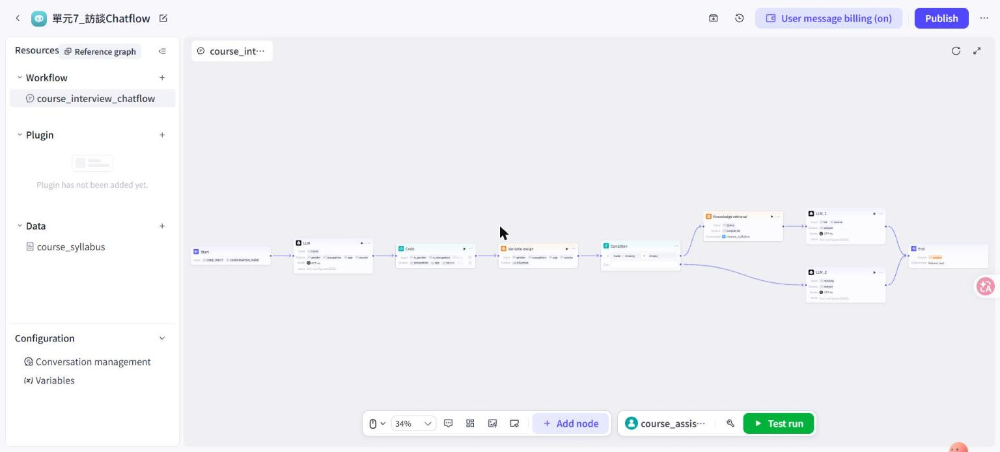
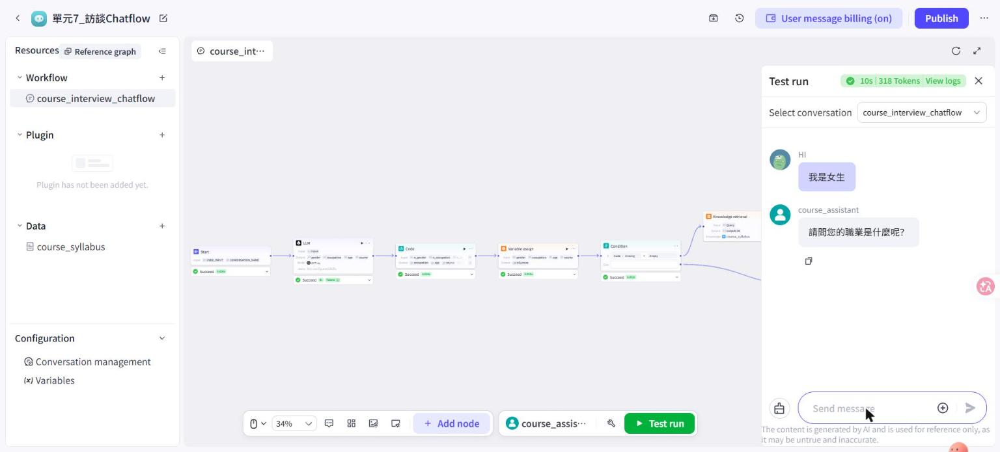
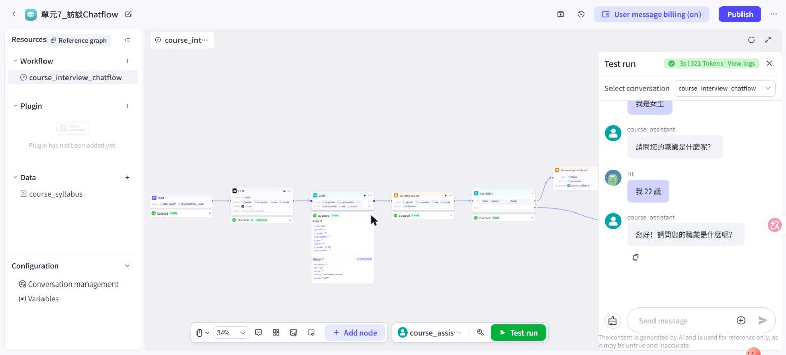
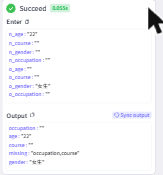

# Agent 的記憶：用變數跨輪記住使用者、缺欄位就追問（單元 7）學習文件

專案：客服 Agent（AuraBrew 模擬產品，假資料，老師允許）　姓名 / 學號 / 班級：趙若軒 / 113801517 / 生醫三　Repo：https://github.com/hehehe2306/auraBrew-support-agent

**期末專題目標：**做一個「美股 IBKR 個人財務分析助理」Agent——讀取 IBKR 模擬帳戶的持倉與餘額，結合利率、匯率等宏觀資料，解釋保證金與利差帶來的風險，並稽查自己算出的數字有沒有錯；只做分析與稽查，下單與槓桿水位交給人決定。本週的單元 7 對應其中「資料不齊就先問、齊了才往下算」：帳戶欄位缺了不能猜著算，這和本週的「缺欄位就追問」是同一個結構。

> 草稿狀態（2026-11-13）：流程已建完，**只測到兩輪**。額度在第 3 輪用完（附圖 6），所以「四欄補齊後查知識庫」這條路、單句四欄齊（A）、知識庫查不到（C）**都還沒有實測結果**，下面對這幾項只寫「預期」並明確標示。「這一節教了我什麼」的觀點由我整理，**待你用自己的話改寫**。

## 結論摘要

**核心觀念：**對話 Agent 的「記憶」不是模型自己記得，而是我把使用者資訊存進**會跨輪保留的變數**，每輪再用一段**固定規則**把「本輪新抽到的」和「之前記住的」合併；至於缺什麼、下一步走哪條路，也是流程節點決定，不是讓模型自己看著辦。

**做了什麼：**在 Coze 建一個 Chatflow：抽取 LLM → Code 節點合併 → 寫回 User variable → Condition 判斷「還缺不缺」→ 缺就走追問 LLM，齊了就查知識庫再回答（附圖 1）。

**目前實測到的（只有兩輪）：**

- 第 1 輪「我是女生」→ 追問「請問您的職業是什麼呢？」（附圖 2）。
- 第 2 輪「我 22 歲」→ 仍追問職業（附圖 3）。**這句回答本身不能證明記憶有效**，因為模型從缺的欄位裡挑職業問，記憶壞掉時也可能這樣回。所以我看 Code 節點的實際輸入輸出：`o_gender="女生"`（讀到第 1 輪存的值）、`n_gender=""`（本輪沒提）、`n_age="22"`，輸出 `gender="女生"`、`age="22"`、`missing="occupation,course"`（附圖 4、5）。**性別被記住，沒有被本輪的空值洗掉。**

**最值得記的坑：**① 「兩輪就沒額度」本身就是設計限制：每輪至少兩次模型呼叫（抽取 + 追問或回應），額度 10 在第 3 輪用完；② 只看模型的回答無法判斷記憶有沒有用，要看節點的輸入輸出。

**主問題（先寫下，之後對答案）：**把「合併規則」和「缺不缺欄位」從模型手上拿到程式和流程節點，Agent 的行為會更可預期嗎？目前只有 M0 一個證據，其餘待額度恢復。

## 零、概念

課綱要我學三件事：記憶（memory）、知識庫（knowledge）、重複對話的訪談流程。

**1. 記憶是什麼？** 推理：LLM 本身每次呼叫都沒有上一輪的狀態，所以「記住」只能是我把資訊存到某個地方、下一輪再讀回來。Coze 有兩種變數，**這是我讀變數設定頁的說明文字推的**，官方文件我沒另外查：App variable 的說明是「每次新請求都初始化成預設值」，所以不能拿來跨輪記；User variable 的說明是「持續儲存」，我用它。實測上，User variable 在第 2 輪讀到了第 1 輪的值（附圖 4），這點是實測的。

**2. 訪談流程的本質。** 這其實是 NLP 常說的「槽位填充（slot filling）」：預先定好要收集的欄位（性別、職業、年紀、想上的課），每輪抽欄位、合併、檢查哪個還空著，空著就問，全部齊了才進下一步。

**3. 知識庫（RAG）在這裡的角色。** 欄位齊了以後，用「想上的課」當查詢字串去知識庫找資料，再讓 LLM 只依檢索結果回答。這段沿用單元 4 學過的 RAG 觀念，本週沒有新的發現，**查詢這條路還沒實測**。

**IPO（老師的檢查方法）：**

| | 抽取 LLM | Code 合併節點 | 條件判斷 | 追問 LLM |
| :- | :- | :- | :- | :- |
| Input | 使用者本輪原話 | 本輪抽到的 4 欄 + 記住的 4 欄 | Code 輸出的 `missing` | `missing`（缺哪些） |
| Process | LLM 依 Prompt 判讀，沒提到回空字串 | 本輪非空就覆蓋，否則保留舊值；算出缺哪些 | `missing` 是否為空 | LLM 在缺的欄位裡挑一個問 |
| Output | 4 個字串欄位 | 合併後 4 欄 + `missing` | 走「查知識庫」或「追問」 | 一句追問 |
| 怎麼驗證 | 對照原話（單元 6 做過） | 看節點輸入輸出（M0，附圖 4） | 看實際走哪條線 | 只問缺的、不重問已知的 |

## 一、實作簡介與檢核標準

**課綱檢核標準：**

1. 一個 Chatflow 的流程截圖與實際對話截圖。
2. 使用者說話時，LLM 嘗試提取性別、職業、年紀、想上什麼課，並填回 variable。
3. 任一 variable 沒填妥，開啟一個 LLM 跟使用者對話，要求填妥。
4. 四個參數都滿足，查詢 knowledge，把結果交給 LLM 回應。

**我的設定與「為何存在」：**

| 設定 | 我的值 | 為何存在 / 解決什麼問題 |
| :- | :- | :- |
| 記憶變數類型 | User variable（gender、occupation、age、course） | App variable 每次請求都重置，記不住；User variable 才跨輪保留。 |
| 合併節點用 Code，不用 LLM | JavaScript，「本輪非空才覆蓋」 | 這是固定規則，寫成程式不會漏；讓 LLM 合併，它可能把舊值弄丟，而且我看不出是哪一步壞。（這是設計理由，沒有做 LLM 合併的對照實驗。） |
| `missing` 字串 | 缺的欄位用逗號串起來 | 同時給「Condition 判斷是否為空」和「追問 LLM 知道問什麼」兩個用途，只算一次。 |
| Condition | `missing` is empty → 查知識庫；否則追問 | 「還缺不缺」由流程決定，不交給模型判斷。 |
| 追問 LLM 的 Prompt | 「只問缺的其中一個、不回答課程問題」 | 一次問一件事，使用者比較不會漏答。（效果只看到兩輪，樣本太小。） |
| 回應 LLM 的 Prompt | 「只依檢索結果回答，沒有就說沒資料，不編造」 | 防止沒查到時模型自己編課程細節（延續單元 4 的 RAG 幻覺問題）。**未實測。** |
| Knowledge retrieval | 搜尋策略 Hybrid、最大召回與最小匹配度用預設、**關閉 Query Rewriting** | 關掉改寫：它會多一次模型呼叫（耗額度），也讓實際送去查的字串不可控。（耗額度是我的推論，沒量測。） |
| 兩個 LLM 的輸出格式 | Text（不是預設的 JSON） | 追問與回應要直接給人讀，不是給下游節點解析。 |
| End 輸出 | `{{output}}{{ask}}` 兩個變數接在一起 | 兩條分支互斥，只會有一個有值。**沒跑到的那條會不會是空字串，還沒驗證。** |

合併規則（我實際輸入的是單行版本，下面是等價的展開寫法）：

```js
// 對 gender / occupation / age / course 各做一次
const pick = (n, o) => (n && String(n).trim() !== "") ? String(n).trim() : (o || "");
const gender = pick(params.n_gender, params.o_gender);   // n_ = 本輪新抽到的，o_ = 記住的
// ...其他三欄同理
const missing = [["gender", gender], ["occupation", occupation], ["age", age], ["course", course]]
  .filter(x => x[1] === "").map(x => x[0]).join(",");
return { gender, occupation, age, course, missing };
```

## 二、測試集

先寫每個測試要回答的觀念問題，答完就停，不為湊案例數。

| 編號 | 輸入 | 要回答的問題 | 預期（寫在測試前） | 實際結果 |
| :- | :- | :- | :- | :- |
| M0 | 輪 1「我是女生」→ 輪 2「我 22 歲」 | 記憶有沒有跨輪寫入、讀出？ | 輪 2 的 Code 輸入讀到性別 | **通過**：`o_gender="女生"`，輸出 `gender="女生"`、`age="22"`、`missing="occupation,course"`（附圖 4、5） |
| B | 輪 1「我想上課」→ 輪 2「我是 22 歲女生」→ 輪 3「學生，想學 AI Agent」 | 追問只問缺的、舊值沒被洗掉、補齊後走查詢？ | 輪 3 走知識庫並回應 | **只測到 M0 這兩輪（輪 1 輸入實際是「我是女生」）；輪 3「學生，想學 AI Agent」送出後額度用完（附圖 6），沒有結果** |
| A | 單句「我是 22 歲的女生，職業是學生，想上 AI Agent」 | 四欄一次齊，不追問直接查？ | 走知識庫 | **未測** |
| C | 四欄齊但課程是資料裡沒有的（如 Python） | 查不到時會不會編造？ | 回覆說課綱沒有 | **未測** |

結果分析（只寫有證據的）：

1. M0 通過。Code 節點在這個 Coze 版本能執行，User variable 能跨輪讀取。這個結果說明**這個設計的記憶是可行的**，不說明它穩定（只有一組輸入）。
2. 第 1、2 輪的回覆都是問職業，兩輪模型都沒有問已知的性別。但如上所述，第 2 輪的回答本身不是證據，要看節點輸入輸出才算。
3. 測試 B、A、C 都沒有結果，包括「Variable assign 寫入的值是否正確」（只間接看到第 2 輪讀到第 1 輪的性別），不能寫成通過。

## 三、業界會怎麼做、我的判斷

**「這一節教了我什麼」（草稿，待你改寫成自己的話）：**

1. 記憶是我設計的：存在哪、怎麼合併、什麼時候清掉，都不是模型的功能。出問題時我能指到是哪一步（附圖 4 就是這樣找到證據的）。
2. 只看模型的最終回答容易被騙：第 2 輪的回答「看起來正確」，但單看這句無法區分記憶有效或失效。要看中間節點的輸入輸出，這和老師講的「執行鏈除錯、可觀測性」是同一件事。
3. 模型仍可能錯：抽取 LLM 一旦把值抽錯（例如把玩笑話當職業），而「本輪非空就覆蓋」的規則會讓錯值覆蓋掉原本正確的舊值，**而且之後都不會被發現**。這是我從規則推出來的風險，**沒有實測**。

**幾個我想到但都還沒驗證的風險（標明是推論）：**

- **記憶汙染與隱私：**User variable 是持續儲存，我是從設定頁說明讀到的。如果之後同一個使用者開新對話，上次的值還在，測試 A、C 前必須先清空，否則結果會被上次的值汙染。性別、年紀是個資，真實產品要想存多久、誰能看。
- **使用者更正：**使用者說「我其實是男生」，因為「非空就覆蓋」，會被更新成新值——這種情況合併規則是對的；但沒有測過。
- **Token 成本（有數字）：**測試面板顯示第 1 輪 318 Tokens、第 2 輪 321 Tokens（Test run 面板右上角的數字）。額度 10 在兩輪對話後用完，**我不知道建知識庫的過程是否也扣了額度**，所以「每輪耗多少額度」沒法精確算。
- **與專題的關係：**專題的稽查程式 `experiments/check_margin.py` 一開始就先檢查欄位有沒有齊，缺了回報「缺欄位」而不是硬算。這和本週「缺欄位就追問」是同一個原則，差別是稽查程式是回報、對話 Agent 是問人。

## 四、換工具會長什麼樣子（沒有實作，只是推論）

在 Claude Code 或自己寫 API 時，上面的流程大致是：狀態放在一個 dict 或 JSON 檔，合併規則是一個普通函式，可以寫單元測試直接驗證（輸入「舊狀態 + 本輪抽取」、期望輸出）；缺欄位檢查是另一個函式。這樣就不需要靠消耗額度的 Test run 來驗證合併規則，測試是免費且可重複的。這點和單元 6 的結論一致：公式、規則歸程式，語意判斷歸 LLM。（**沒有實作，只是推論。**）

## 五、踩坑（平台操作，只留一行）

- 在 Coze 面板裡「向下捲動後座標會變」，我連續盲打時兩次把名稱疊進錯的欄位，後來改成每步截圖、用 DOM 讀回值確認。
- Code 編輯器自動縮排會把多行貼上弄亂，所以我輸入成單行。
- 畫面卡住（renderer 無回應）時，等十幾秒就恢復，沒有遺失資料。
- Chrome 擴充功能中途斷線多次，期間沒有任何畫布操作，也沒有編造結果。

## 六、限制

- 只測 2 輪，只有 M0 一個證據；查知識庫的那條路（含 Variable assign 寫入的正確性、End 在互斥分支下的輸出）完全沒有實測。
- 額度限制：10 額度在兩輪對話後用完；補齊 B、A、C 需要分幾天，而且 A、C 前要先清空 User variable。
- 知識庫檢索結果是否有用沒看過：課綱檔匯入後顯示 1 份文件、8 個片段（自動分段、Quick Parsing）；這 8 個片段切得合不合理、查「AI Agent」會不會撈到對的單元，**都還沒驗證**。
- 這份是草稿，「這一節教了我什麼」要由我自己用自己的話改寫。

## 附圖

- 附圖 1：完整 Chatflow 流程圖（Start → 抽取 LLM → Code → Variable assign → Condition → 知識庫 → LLM_1 / LLM_2 → End）。

  

- 附圖 2：第 1 輪「我是女生」→ 追問職業。

  

- 附圖 3：第 2 輪「我 22 歲」→ 仍追問職業（單看此圖不能證明記憶有效）。

  

- 附圖 4：第 2 輪 Code 節點的實際輸入與輸出（證據）。

  

- 附圖 5：附圖 4 的局部放大（`o_gender="女生"`、`n_age="22"`、輸出 `missing="occupation,course"`）。

  

- 附圖 6：第 3 輪送出後回「Out Of Credits」，測試 B 第 3 輪沒有結果。

  
